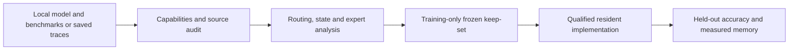

# Paper direction and contributions

## Current question and deadline

**Accepted October 8 direction (ADR20261008 09):** analyze all seven models carefully and ground the paper's routing/state and accuracy–memory results. A package accepting a local MoE and benchmarks is the eventual output of those validated findings. Its first deployment objective is **reduced resident expert memory, with answer accuracy measured jointly**. The target is Computational Linguistics, with results needed by October 15. No external validators or failure-centered publication fallback are requested. The first comparison uses the user-selected common percentage reduction in expert bytes across models; the exact percentage is still open.

**Which reproducible routing and reasoning-episode patterns can inform expert retention, and what accuracy–resident-memory tradeoff does a frozen policy achieve on held-out problems?** Existing evidence answers parts of the first clause. Modified-model accuracy and actual memory reduction remain unmeasured. Unfavorable and uncertain results retain their original scope in the evidence ledger and appendices.

## Contribution hierarchy

| Contribution | Available evidence | Necessary remaining evidence |
|---|---|---|
| C1. Comparative routing and visible reasoning episodes across seven MoEs | Math scores; seven-model clean state readout; class transitions and expert profiles; two clean next-class studies | Clear population, automated-label, missingness, nuisance-control and checkpoint scope; export existing results without regenerating them |
| C2. Auditable expert keep-set proposals from those profiles | Grouped evaluation, matched contrasts, candidate cards, per-attempt counts, serialized expert-byte inventory and new state-coverage curves | Training-only ranking/selection, stability and baseline comparisons at an explicit byte target; minimal measurement code over existing machinery |
| C3. Joint accuracy and actual resident-memory evaluation | Historical mask interventions and qualified native execution provide context | A separately qualified resident operator, independently held-out modified-model outcomes, measured bytes, compatible scoring and finite measured prices |

**Latest user clarification:** focus now on results for the paper; defer public API and general deployment work. New code must implement or verify a specific paper measurement. The eventual package delivers the validated procedure; it is not a separate current workstream or empirical proof of C2/C3. C1 already has positive support. Low use or state enrichment does not establish safe removal. C3 across seven heterogeneous quantization and routing implementations is the main one-week engineering risk.

## Research workflow and eventual package output

1. **Inventory and analyze.** Resolve architecture from checkpoint configuration, record supported signals/operators, and join benchmark questions, duplicate families, attempts, labels and routes. Reuse existing `correlation-*` and `correlation-dynamics` modules. Routing-only analysis needs no external labels; missing labels break state adjacency.
2. **Propose a keep-set.** Bind the selection rule, training families, layer quotas and byte target. Separate frequency, state-associated coverage and output-aware baselines. Static selection may use retrospective training labels; online state-dependent policies require prefix-only inputs. Neither may use evaluation outcomes.
3. **Evaluate a resident implementation.** Preserve native selector/group/k/shared-expert semantics, map original IDs to retained slots, and actually omit or release storage. Compare full model, profile-informed selection and appropriate frequency/random or established baselines at equal bytes. Report expert bytes, whole-model bytes, fixed-context peak memory and paired accuracy separately.

Reports distinguish **observational**, **selection frozen**, **mask checked**, **resident measured**, and **unmeasured/unsupported**. A routing mask that retains every tensor cannot report memory savings. Packed scales, shared storage and tensor-parallel ownership belong in byte accounting. Arbitrary local snapshots require capability checks, not a Qwen fallback based on a directory name.

The [source review](debate/package-analysis-review-20261008.md) identifies reusable modules; its public-interface suggestions are deferred until the paper results establish what to package. [The result inventory](../../report/model-analysis-review-20261008/INVENTORY.json) and [checkpoint headers](../../report/model-analysis-review-20261008/CHECKPOINT_HEADER_INVENTORY.json) bind reuse; serialized bytes are not measured GPU allocations.

## Evidence and intended exhibits

| Exhibit | Question and boundary |
|---|---|
| Benchmark table | Two separate 32,529-attempt corpora, each on 1,547 shared questions, six benchmarks and seven models. Show scoring, unknowns and caps; native profiles do not give an equal-budget ranking. |
| Routing readout table | Seven clean present-class results,522 questions/509 families each. Automated visible-episode information beyond the saved nuisance baseline does not establish latent cognition. |
| Transition and conditional-expert exhibits | All-seven descriptive summaries; clean next-class evidence for GPT/Qwen3.6; existing Qwen family-crossfit profiles retain their narrower scope. |
| Selection-coverage figure | Retrospective cohort-A labelled-slot concentration and least-covered state. No held-out, executed-weight, accuracy or memory-saving claim. |
| Prospective selection/resource table | Training-family ranking comparisons and actual tensor-byte accounting; expert count differs from total resident memory. |
| Joint accuracy–memory table | Missing resident implementation and modified-model evaluation; old force-off continuations cannot fill it. |

Use family-held-out comparisons and shared-family uncertainty for combined claims. Seven checkpoints are not seven independent samples or unrelated architectures. A nonsignificant accuracy difference does not establish retention. A joint tradeoff estimate needs no noninferiority margin; a later negligible-loss claim would require a declared margin and adequate precision.

## Prior work and novelty boundary

Frequency-based compression and output-aware pruning already exist: [EAC-MoE](https://aclanthology.org/2025.acl-long.633/) and [REAP](https://arxiv.org/abs/2510.13999) are relevant baselines; [counterfactual routing analysis](https://arxiv.org/abs/2605.07260) already studies routing alternatives. The proposed contribution concerns the incremental value of state-associated profiles and a reproducible decision workflow, with memory/accuracy evidence where measured. A counts-only score cannot be called REAP without its output statistic and faithful implementation. Packaging does not establish novelty or publication readiness.

## Preserved verification campaign

ADR-06's minimal verification v3 remains a separately interpreted campaign. Its positive singleton pulse, recognizer gates, native/random controls, assignments, source closure and protected handoffs are unchanged. [The fixed contract](NEXT_EXPERIMENTS.md), [decision records](DECISIONS.md) and original protocol remain authoritative for those jobs. This priority change creates no cancellation or dispatch authorization.

All seven models remain in the analysis and eventual usefulness matrix. Starting engineering with one supported format does not complete seven-model causal or memory scope. Missing cells stay explicit. New computation requires the standing publication gate and finite measured workload authorization.
