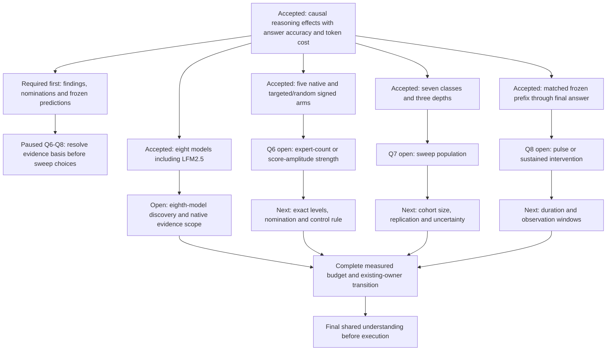

# Final routing experiments: agreement in progress

Date: 2026-10-15. Status: design discussion; the complete execution contract and
workload have not been approved. This document records answers as they arrive.

## Accepted direction

The author requests direct expert (de)activation for the final paper experiments.
Physical expert compaction, packed-weight repacking, compact-shape qualification,
and accuracy-versus-resident-memory curves leave the proposed completion path.
Earlier measured outcomes and failed allocations retain their original status.
Resident-memory or per-token compute savings are not established by intervention
on routing with the original weights and top-k still in use.

The intended scientific sequence is: reasoning-state information in routing;
state dynamics and expert nominations; assigned routing interventions; behavioral
response and answer quality/token cost from those same continuations.

The final experiment asks whether expert sets associated with a reasoning state
can causally change its expression from a shared partial solution. The native
arm measures the untreated continuation; the same-sign random arm tests whether
the response is specific to the nominated experts. Activation and deactivation
test the two intervention directions. Answer accuracy and token counts show the
consequences for these continuations. A supported behavioral effect need not
improve accuracy, and null or uncertain effects remain valid results; neither
justifies selecting a new configuration using the confirmation outcomes.

## Answers received

| Decision | Author's answer |
|---|---|
| Q1: final scientific objective | Causal reasoning effects, with accuracy and token cost measured on the same runs. |
| Q2: model scope | Eight models, explicitly including LiquidAI/LFM2.5-24B-A2B. |
| Q3: intervention arms | Native, targeted activation, targeted deactivation, random activation, random deactivation. |
| Q4: breadth | All seven reasoning classes, all three depths, and a strength sweep. |
| Q5: starting point | The same frozen prefix within each matched comparison, continued to the final answer. |

These answers supersede the physical-memory priority in earlier planning ADRs
for the revised study. They do not by themselves modify the accepted r6 graph,
release revised work, change a sealed source, or approve a new resource envelope.
The final transition from existing owners needs an agreed, reviewable procedure.

## Author requirement: findings before the run matrix

The author requires the completed correlation, extraction and intervention
analyses to determine the next scientific questions. Q6–Q8 are paused while
that connection is made explicit. The accepted breadth above remains recorded;
it does not imply that every class/depth/strength cell is an equally supported
primary hypothesis. A sweep needs a declared localization, dose-response or
generalization question before its execution budget is chosen.

The source audit finds that the current r6 design is partly analysis-derived.
For each held-out family fold, it nominates experts from the other four folds
using class-versus-other-class inclusion differences, with family/benchmark
weighting. It selects the strongest layer within each depth third, forms sets
covering 25/50/75% of positive excess, and matches random controls on set size
and routing-frequency quintiles. Discovery sentence lengths determine the pulse
quantiles. These are real uses of the prior data.

All 735 retained nominations (105/model) resolve to the frozen v1 manifests;
they were not newly derived by the overnight r6 measurement jobs. Every record
has a nonempty central set; observed family support spans 713–1,188 and observed
stability spans 0.625–1. These discovery summaries are not confirmation results.
Inherited association-confirmation files are present for GPT, Nemotron and
Qwen3.5, with 84/210, 42/210 and 126/210 estimable entries respectively; remaining
entries are marked insufficient support or degenerate. The other four model
directories have no such file at audit. Thus there is no complete seven-model
confirmation result to cite. Example artifacts:
[GPT nominations](../../../report/research-campaign-v3-20261014-r6/gpt/NOMINATIONS.json)
and [GPT confirmation](../../../report/research-campaign-v3-20261014-r6/gpt/ASSOCIATION_CONFIRMATION.json).

However, three depth thirds and the configuration grid are preset design choices.
Stability is a layer-selection tie-breaker, not an enforced support threshold.
Source-conditioned transitions, coordination and transfer findings do not feed
the current target selector. Planned dose calibration uses saved router scores,
but no completed calibration/configuration receipts were present in the audit.
Calling the entire schedule a consequence of all prior findings would overstate
the evidence. Sources: [discovery derivation](../../../src/moe_exp/research_campaign_v3_r6/derive.py),
[nomination and controls](../../../src/moe_exp/research_campaign_v3_r6/design.py),
[calibration](../../../src/moe_exp/research_campaign_v3_r6/measurement.py),
[task enumeration](../../../src/moe_exp/research_campaign_v3_r6/tasks.py).

The evidence supports the following proposed chain. These rows motivate one
coherent intervention study, rather than five separate new experiments.

| Retained finding | Prediction or unresolved question | Consequence for the final study |
|---|---|---|
| Current-class routing readouts improve over text baselines in all seven evaluated models. | Do class-associated experts participate in producing the class, beyond carrying predictive information? | Use discovery-nominated targets; compare each sign with native and same-sign controls. Measure the full seven-class response so generic disruption is distinguishable from the predicted response. |
| Qwen3.6 L28/E189 and E9 precede Verify with matched inclusion differences +0.08118/+0.06296, positive in 40/48 and 44/48 discovery families. | Promoting or suppressing the nominations may respectively increase or decrease subsequent Verify-labelled behavior. | This is a concrete example of a grounded hypothesis. It does not independently validate the final fixed pair, establish substantive verification, or supply targets for other models. |
| GPT and Qwen3.6 routing adds next-class information; native dynamics distinguish entry into a class from persistence in it. | Do source-conditioned nominations affect entry, while current-class nominations affect persistence? | State the prefix condition and prediction before evaluation. Separate entry from occupancy; an arbitrary-prefix intervention cannot establish an entry-specific mechanism. Online trigger qualification remains absent. |
| Earlier sparse actions changed target inclusion, but FRESH force-minus-native semantic success is +5.50 pp with interval [−4.50, +15.50]; none of 28 primary contrasts excludes zero. | Does target engagement translate into a selective behavioral change beyond matched perturbation? | Routing engagement is a manipulation check. The new evidence must resolve behavioral response and measure final-answer accuracy/token cost on those same continuations. Historical capped runs do not fill the new utility cells. |
| Complete global steering comparisons show no strictly positive accuracy interval; strong promotion has caused substantial harm. | Can a bounded intervention produce selective control without generic degradation, and how does that depend on dose? | Calibrate against native routing on discovery data and declare the dose question. A larger numerical strength is not presumed beneficial or comparable across models. Preserve harmful and null outcomes. |

Evidence: [readout and anticipation](../FINDINGS.md#e03-routing-information-and-anticipation-already-exist),
[conditional nominations](../FINDINGS.md#e04-targets-are-grounded-candidates-not-semantic-modules),
[global interventions](../FINDINGS.md#e05-legacy-global-steering-provides-substantive-negative-evidence),
[sparse interventions](../FINDINGS.md#e06-sparse-actions-engage-routing-semantic-effects-remain-uncertain).

The small retrospective correctness correlations do not set a utility policy.
In particular, the negative Verify correlation does not predict that suppressing
Verify experts improves answers; difficulty and compensatory checking remain
possible explanations. State-balanced coverage is also model-dependent and
supports controlling for native expert frequency, without predicting accuracy.
Random controls address a specific question: do the discovered identities matter
beyond a comparable routing perturbation? The inherited sampler permits overlap,
including one identical central target/control set; revised controls need a
declared rule and cannot count an identical set as an independent identity test.

Before freezing the workload, record for each primary model/class hypothesis:
the discovery source and family split; supported target identities and layer;
association magnitude, stability and uncertainty; prefix condition; predicted
behavioral direction; control construction and attained perturbation; primary
outcome, precision target and what result would contradict the prediction.
Preserve unsupported and unestimable cases explicitly. Use only discovery
families to choose sites and doses. Previously inspected evaluation outcomes
are development evidence for revised choices; independent confirmation requires
an unused population or an appropriate frozen cross-fitting design.

Recommended interpretation of the accepted breadth: nominate sites from evidence
within the three depth regions and test a stated localization/generalization
question across them; use the strength sweep to test a calibrated dose response.
One proposed cross-site prediction is that stronger, more stable discovery
association predicts a larger target-specific behavioral response at comparable
routing perturbation. The same intervention outputs can test that prediction;
it is not an established consequence of the association scores. Its analysis
must respect shared families, selected nominations and model differences.
Do not select the best observed cell and retrospectively call it the primary
experiment. There is currently no established universal best depth. Any change
to the author's requested breadth remains a decision for the agreement round.
LFM2.5 must first supply its own comparable discovery evidence.

## Design tree

## Reference method and terminology

[Steering MoE LLMs via Expert (De)Activation, section 3.2](https://arxiv.org/html/2509.09660v2#S3.SS2)
modifies nominated router scores before native expert selection. Its official
implementation preserves allocated experts and native top-k. Its strength knob
is the number of nominated experts, with a fixed score override; a deprecated
score-magnitude argument is not the operative sweep.
[Official selection code](https://github.com/adobe-research/SteerMoE/blob/main/src/utils.py#L67-L116),
[official Qwen operator](https://github.com/adobe-research/SteerMoE/blob/main/src/modeling_vllm/qwen3_moe.py#L114-L157).

The exact operator, strength levels, duration, controls and held-out sweep
allocation remain to be agreed. The existing additive-bias calibration and hard
eligibility mask are different operators. Neither is silently renamed as a
reproduction of the reference. Native grouped routing, correction biases and
mixture normalization must be accounted for per model.

## Reframed to-do list

- [x] Audit overnight evidence. All nine retained saved-sequence shards completed,
  covering 10,822 forwards for the existing seven models. The CPU analysis pilot
  completed. Coordination continues; the 09:17 audit found 77 Qwen3.5 pair result
  receipts, alongside the previously complete GPT 81 and Nemotron 77 banks.
- [x] Retire physical compaction and its seven failed first-shape checks from the
  revised paper's required experimental path. Retain their historical receipts.
- [x] Agree the five choices above.
- [x] Audit whether the current selector and schedule use prior findings; record
  the evidence-to-hypothesis map and the remaining gaps above.
- [ ] Assemble discovery evidence and explicit predictions for each primary
  model/class hypothesis; distinguish entry from persistence and audit control
  overlap, support, stability and independent confirmation.
- [ ] Justify the retained depth/strength coverage through those predictions,
  then resume Q6–Q8 and specify the primary comparisons and precision target.
- [ ] Freeze one explicit routing operator and its strength/duration sweep.
- [ ] Agree the confirmation population and the population assigned to sensitivity
  curves, seeds, controls, stopping and uncertainty reporting.
- [ ] Establish LFM2.5's native profile, discovery evidence and prefix/nominations.
- [ ] Prepare a separately bound resident-routing implementation with small
  inactive-path, target-engagement, finite-output and native-routing checks.
- [ ] Measure the required execution and annotation prices; admit the complete
  agreed workload, including LFM preparation, within the retained accounting
  ceiling and reserves. Do not infer cost from expert count alone.
- [ ] Execute the agreed matched continuations and annotate their reasoning
  outcomes; score final answers and generated-token cost from the same outputs.
- [ ] Complete the retained supporting analyses and export effect/quality/cost
  figures with uncertainty, failed assignments and unknown outcomes represented.

## Workload consequences to resolve

If all 129 existing evaluation families receive all seven class targets, three
depths, three strengths and four nonnative arms on each of eight models, the
design has 260,064 intervention continuations, before compatible native reuse.
This is a conditional arithmetic count, not an accepted task table or a price.
Reducing engineering prerequisites does not remove this factorial workload.
Existing unusable prefixes and any exact execution aliases require explicit
reconciliation; their existence must not become a fresh outcome-dependent draw.

The first unresolved task is to connect the retained findings to frozen primary
predictions and their required comparisons. Strength, held-out support, duration
and annotation windows follow that scientific question. Q6–Q8 remain pending;
the author requested this evidence audit before answering them. No choice is
silently inherited solely because it appears in an older campaign.

## Reuse and the eighth-model prerequisites

For each of the seven existing models, r6 retains native accuracy, five-fold
nominations (105/model: seven classes times three depths times five folds),
prefix manifests, native profiles and the saved routing measurements. There are
129 prefix entries/model; Nemotron and Qwen3-30B each preserve one unavailable
entry. Compatible native suffixes may be reused under their exact profile and
estimand checks. Existing historical interventions have their own populations
and cannot fill different prospective cells.

LFM2.5 is explicitly included by Q2. The bounded local audit found its
[planned-model record](../../6a510c6db0d9b08aa438c142/journal/PLANNED_MODEL.json),
but no qualified native measurements, annotations, nominations or prefixes.
Installed vLLM recognizes Lfm2MoeForCausalLM. The current project matcher misses
its feed_forward.experts modules, and its native sigmoid routing/correction
biases require a scoped integration. It has 64 experts and native top-k four.
Checkpoint availability, native sampling, reasoning parsing and full evaluation
compatibility still need verification; architecture support alone is insufficient.

Each existing model's discovery source contains 1,547 assigned native traces over
1,486 duplicate families, with five shared family folds. Matching that discovery
support for LFM requires the corresponding native traces and seven-class labels.
The 4,647-attempt native benchmark table is a larger population, including repeated
math attempts. Full manuscript-panel parity would also add LFM's native readout
fit/evaluation on 522 questions over 509 families and its descriptive routing
analyses. Whether the eighth-model addition includes those wider native panels,
or the final intervention study with comparable discovery and native controls,
remains an explicit scope decision.

With Q5, effects describe completing answers from the selected frozen prefixes.
They do not automatically estimate a deployable policy beginning at the original
question. Record both new and total tokens. Reused native elapsed-time sentinels
cannot establish inference-speed gains.

## Reusable measurement contract, pending agreement

The previous steering contract has two co-primary behavioral outcomes: whether
the first complete generated reasoning sentence has the targeted class, and
target-class token occupancy after the pulse through the registered window.
A sustained intervention would instead need an explicitly agreed within-window
occupancy outcome, with no post-pulse recovery claim. The existing annotation
pipeline labels sentences starting within the bounded analysis window, retaining
the first complete sentence; final-answer scoring uses the complete continuation
without requiring every answer sentence to be annotated.

Existing paired family inference, benchmark/family weighting, reader reuse and
unknown-outcome bounds are available for the revised design. Their exact reuse,
the primary strength point versus sensitivity curves, and replication remain
to be agreed. Missing executions or labels are not silently counted as negative
behavioral results. These measurements concern the reader-defined reasoning
classes; missing-label bounds do not independently validate the reader.

Sources: [original endpoint contract](../../../src/moe_exp/research_campaign_v3_r6/contracts.py),
[behavioral responses](../../../src/moe_exp/research_campaign_v3_r6/responses.py),
[bounded annotation](../../../src/moe_exp/research_campaign_v3_r6/annotation.py),
and [answer/token scoring](../../../src/moe_exp/research_campaign_v3_r6/scoring.py).

## Workflow

The requested grill-with-docs wrapper invokes grilling and domain-modeling.
The installed grilling instructions are in use. No domain-modeling skill was
found in the bounded installed-skill searches; this draft uses the project's
existing ADR and glossary conventions. The final agreement will precede
implementation and workload changes, as required by the grilling workflow.
