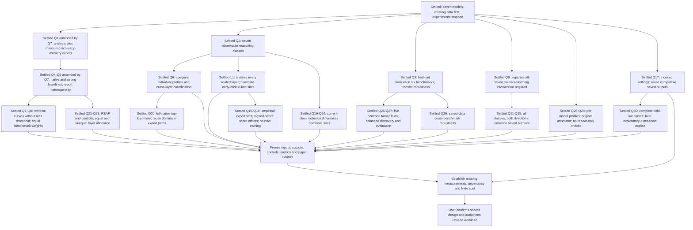
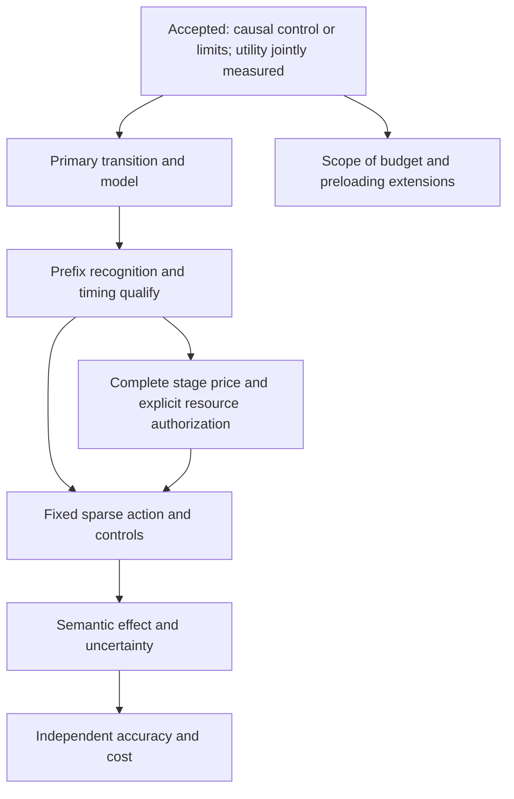

# Research decisions and open questions

## ADR 20261014 24: r6 reader repair and remaining-study launch

**Observed validation exhaustion — 2026-10-14:** the single recovery 60484614
passed all 111 contracts but failed before the actual import because the
standalone runner's relative imports had no package context. Both allocations
are FAILED 1:0, totaling 0.96 actual local hours (1.20 with margin). The sealed
implementation and failed receipts remain unchanged. Actual import, installed
reader validation and full export/PDF validation are still unverified; scientific
release and ownership transfer did not occur. Existing October 15 owners remain
pending. The separately prepared candidate runner sets the package explicitly;
its import preflight passed without submitting or running the validation graph.
The [terminal receipt](../../report/research-campaign-v3-20261014-r6/VALIDATION_TERMINAL.json)
and [pending correction binding](../../report/research-campaign-v3-20261014-r6/VALIDATION_RUNNER_CORRECTION_BINDING.pending.json)
record the exact gate. A further allocation requires an explicit extension of
the user's approved one-recovery limit; this observation grants none.

**R6 validation ownership — 2026-10-14:** source seal
`cab3d55b383d5c6b00e8a1f3e745d415340499b2f6f8c5444085eebaf4c55a14`
binds 186 unchanged implementation/test files and the separately recorded reader
runtime. First validation 60481682 failed after 110/111 contracts passed: the
remaining inherited assertion treated local export as verified remote delivery.
The one separately bound recovery 60484614 uses the corrected delivery test
contract and retains every scientific assertion. Its 11-file binding is
VALIDATION_RECOVERY_BINDING.json; implementation sources remain unchanged.
Scientific work and ownership transfer are gated on actual full validation.
Predecessor snapshot 60454552 and owners 60462231/60462233/60462236 remain owned.
No further validation allocation or automatic successor follows an exhausted
recovery. The original accounting ceiling is not reset.

The user approved the audited repair-and-launch plan and explicitly instructed
implementation. This separately sealed r6 imports r5-r2 and all ancestry, keeping
the seven-model design, original sampling/decoding, frozen cohorts, task/shard
identities and the original accounting baseline. No successful qualification or
completed analysis is repeated.

The user selected recovery of the exact 64 original reader assignments only
when source, distribution fingerprints, launch configuration and failure ordering
prove rejection before engine admission. Admitted or ambiguous interrupted draws
remain unknown. Correct token lengths govern the unchanged context/output
allowance. A necessary maximum-input price uses untouched original observations,
with at most one unpriced shared reader batch.

The user selected full real CPU validation on four CPUs/24 GiB/180 minutes:
12 local hours per attempt before margin, one bounded recovery. It must exercise
all-seven imports, installed reader token/input/sampler boundaries, the full
243,747-row report, checkpoint recovery and a source-bound manuscript build.
Only scheduler/GPU boundaries may be simulated in isolated tests; no simulated
scientific evidence may enter the accepted journals.

Remaining scope is 741 original coordination pairs; 346 non-REAP compact shapes
and 69,459 distinct generations; 10,822 saved-sequence forwards; 35 calibration
folds; eligible REAP, central steering, balanced sensitivity and supporting
analyses. GPT's measured REAP limitation remains in dependent cells. Registered
comparisons, unknown bounds, weighting and simultaneous correction families
remain intact. The 2,291.7-local-hour saved-sequence projection excludes natural
generation and annotation; complete affordability remains unmeasured.

Component failure dispositions preserve independent CPU/compact progression.
Forecasting is read-only; shards commit after their inputs/prices validate.
Reports, local PDFs and each remote delivery have separate completion receipts.
Publication uses explicit allowed artifacts and isolated Git indexes with exact
readbacks and one failed-destination retry.

The new owners and October 15 snapshot must be accepted and verified before
retiring only proven pending zero-runtime predecessors. Every wave reconciles
live entitlement, all inherited charges/reservations and separate WORK/FAST
reserves. Full production requires complete measured admission with 25% margin
inside the original 42,050-hour ceiling. A shortfall stops production without
reducing scientific scope. Exhaustion creates no automatic successor campaign.

## ADR 20261014 23: authorized final r5 continuation and imported-state validation

Terminal observation: all seven native fixtures and corrected Nemotron/Gemma
REAP qualify; corrected GPT REAP remains limited. Original reader pricing
60454682 failed inside vLLM's token-input validation (`min_input_id < 0`) because
string keys were passed instead of integer token IDs. Its numeric decoding
parameters have the expected types. The one bounded deterministic recovery
60456042 preserved the started original reader assignments, without replacement,
and failed when no committed execution price was available. TERMINAL.json records
upstream_unavailable and SHARED_IMPLEMENTATION_FAILURE.json retains both errors.
No complete production admission or new co-primary effect was obtained.

Closeout 60456396 and successor 60456399 with guards 60456401/60456403 own bounded
report/export, and snapshot 60454552 keeps October 15. The exhausted failure does
not trigger source modification, another scientific allocation or a successor
campaign. Full affordability is unmeasured, not an established budget shortfall.
The dated launch/initial-engineering working manuscript and its 146-page PDF were
delivered to GitHub and Overleaf with independent readbacks; terminal report and
terminal manuscript delivery remain separate obligations. Scientific completion
is explicitly false.

First engineering readback: corrected Nemotron REAP is qualified. Corrected GPT
REAP remains a method limitation under the unchanged same-execution fidelity
tolerances; its router bank remains usable. GPT's native full-context fixture
qualifies and measures 32.84375 GiB aggregate owned-process NVML residence.
This does not establish compact removal accuracy or a causal effect. Detailed
source, numerical, accounting and live bounded-wave admission readbacks are in
FIRST_WAVE_OBSERVATION-r1.json. Subsequent ownership is controller 60454686 with
guards 60454688/60454689, accepted before retiring unused initial guards.

The 146-page working manuscript now records these dated engineering observations
in supporting material. Its main wrapper prevents the preserved reproducibility
file from resetting appendix identifiers and prefixes appendix figures, tables
and equations by their unique section. All 14 retained co-primary figures match
the underlying result manifest. The full source-bound offline build and visual
review are recorded separately from ongoing scientific completion and delivery.

Latest observation: the single recovery 60454171 completed `0:0` in 1,098
allocated seconds. It certified all seven measurement manifests, 69,459 non-REAP
generations and 346 compact shapes using real CPU implementations and zero
scheduler submissions. All 102 regression contracts and the 172-file source
closure remain bound; all six ancestor seals validate. The original failed and
timed-out jobs remain preserved. Total validation expenditure is 4.612 local hours
(5.765 with margin), charged within the original ceiling.

Protected launch accepts import 60454550, October 15 snapshot 60454552, controller
60454554 and guards 60454557/60454559. Import completed `0:0` in six seconds using
the committed validated import. Both failure owners and replacement snapshot
were accepted before predecessor snapshot 60226466 was cancelled with zero runtime
and `Start=None`. LAUNCH.json, LAUNCH_VERIFIED.json and OWNERSHIP_TRANSFER.json
record source, job/resource/dependency and retirement readbacks. The initial
bounded preparation is admitted; complete measured production admission remains
required. No new accuracy–resident-memory or steering outcome is claimed by launch.
Later owners and scientific jobs belong to the immutable handoff/submission journals.

The user supplied the final continuation plan and twice instructed “Implement the
plan.” This authorizes its bounded CPU validation and gated Slurm continuation,
plus delivery to the existing GitHub branch and Overleaf project. All seven
models, original scientific identities, cohorts, decoding, controls, thresholds,
10,000 shared family resamples and the original 42,050-hour ceiling persist.
The 25% margin stays inside available entitlement. If the complete measured study
does not fit, production stops with its itemized shortfall; scope is not reduced.

R4 terminated after imported Qwen3.5/Qwen3.6 pilots lacked MEASURE_TASKS.json.
Its OPERATIONAL_FAILURE.json separately preserves the terminal publication error.
Seven repaired derivations, GPT 81/81 and Nemotron 77/77 coordination pairs are
reusable after component/dependency checks. The five remaining banks contain 741
original pairs. Physical memory–accuracy and new steering effects remain unmeasured.

The new implementation is `src/moe_exp/research_campaign_v3_r5/`, with the compatible
launcher `scripts/research_campaign_v3_r5/run.py` and separately sealed root
`report/research-campaign-v3-20261014-r5/`, resuming r4 and its full ancestry.
The seal is `cde12455f8316873954d8a56aeee2626981249764d9a67274b55b757ec1d39f2`.
Validation 60428583 was accepted and observed RUNNING on login08: four CPUs,
24 GiB, 30 minutes, billing four cores and reserving two local hours before margin.
No scientific release or ownership transfer has occurred at this observation.

Updated observation: 60428583 passed 101 contracts but failed the actual GLM
dependency check. The importer had equated different execution/qualification
receipts because their array bytes matched. Its seal and failure are preserved.
The separately sealed repair `src/moe_exp/research_campaign_v3_r5_r2/`, root
`report/research-campaign-v3-20261014-r5-r2/`, resumes it and r4 transitively;
seal `e5fdce1548eda0ace3111efc9d2c46dfd65266d811ab0ea5cc6848d27395aafc`
preserves the original scientific source projection and both GLM identities.

Repaired validation 60434236 passed all 102 contracts in 341.549 seconds. Its
actual import committed all seven measurement/non-REAP manifests, four qualified
REAP components, GPT 81/81 and Nemotron 77/77 coordination pairs. Six original
native-context samples committed before the 30-minute allocation timed out;
READINESS.json was not produced. Accounting records 2,005 elapsed seconds,
including scheduler shutdown, billed at four cores. This is deterministic
validation interruption, not a scientific draw or a shared implementation verdict.

One separately bound deterministic recovery, 60454171, is accepted and observed
RUNNING under the same four-CPU/24-GiB/30-minute envelope. It reuses the original
102-test success log and committed import only after source/dependency verification,
then checks every question/source/mask identity, strict score, original context
sample and real forecast/graph traversal. Full native context banks remain explicit
early CPU work. Its immutable VALIDATION_RECOVERY_BINDING.json limits recovery to
one allocation and binds the independent wrapper. Failure leaves the launch gate
closed with an explicit terminal disposition, without an automatic new campaign.
All validation charges and the two-hour recovery reservation enter admission.

GitHub's previously missing r4 terminal commit was pushed and independently read
back at `9828c52c7c73d1ad786da6dedfe59011f602a800`; the historical failure receipt
is unchanged. The current 145-page PDF still matches its manuscript source snapshot,
and pages 1, 8 and 145 were visually checked. It explicitly retains scientific
incompleteness; this readback is not a new primary result.

The validation replays actual imported manifests, identities, masks, scoring,
native contexts and forecasting. The predeclared non-REAP boundary is 69,459
original generations and 346 compact count shapes plus seven native shapes.
READINESS.json must bind successful IMPORT_GRAPH_VALIDATION.json before launch.
The pending October 15 snapshot 60226466 remains owned until replacement snapshot
and both new failure owners are accepted and verified.

R5 keeps router arrays, norms and diagnostics in their own execution. Four qualified
components are reused; three affected models may each receive one corrected saved
sequence qualification with original sequence/tolerances and explicit historical
supersession. NON_REAP_TASKS, REAP_TASKS and STEERING_TASKS are separate immutable
interfaces. Non-REAP native/compact qualification, retained pricing, strict scoring
and local memory evidence proceed independently of REAP and steering preparation.
One unpriced target role per model and one shared original reader batch remain.

Atomic deterministic import/scoring/context/export has one bounded recovery;
started stochastic units cannot redraw. Genuine limitations affect dependent cells,
and deadlines preserve interrupted originals while allowing untouched assignments.
Local report, manuscript/PDF and independent destination receipts are distinct.
Remote publication preserves success and retries only failed delivery once. Final
closeout has one export-only recovery and then explicit termination. No automatic
source repair or successor campaign follows exhaustion. WORK and authorized private
FAST retain separate 10-GiB reserves; bulk evidence and credentials stay outside Git.

## ADR 20261012 22: authorized results-first r4 implementation and protected launch

The user supplied the results-first continuation plan, instructed “Implement the
plan and make sure to launch everything at the end,” and then said “go on.”
This supersedes ADR21's implementation hold for that unchanged finite plan.
No additional approval is required for its gated continuation or the existing
GitHub branch and Overleaf project. All seven models, original draws, folds,
controls, decoding allowances, cohorts and the original 42,050-hour ceiling
remain binding; production requires complete measured admission and 25% margin.

Implementation: `src/moe_exp/research_campaign_v3_r4/`; launcher:
`scripts/research_campaign_v3_r4/run.py`; intended fresh root:
`report/research-campaign-v3-20261012-r4/`, resuming r3 transitively.
The first deliverable is the fixed 420-question/400-family accuracy–resident-memory
study, followed by central steering on the fixed 129 families and balanced
sensitivity diagnostics. Central primary uncertainty covers all 1,176 contrasts
and 2,352 bound components with 10,000 paired family resamples. Supporting
dynamics and joint utility retain separate declared families.

Historical seals and scientific outputs remain preserved. Verified component
reuse includes GPT's 81 pairs and Nemotron's 55 completed pairs; the missing 22
remain required. Private FAST is authorized for new bulk outputs and temporary
caches. WORK holds code, receipts and compact paper evidence; each filesystem
retains its own 10 GiB reserve. New phase, export, storage and ownership receipts
must establish observed execution; this authorization is not scientific success.

The authorized regression envelope is four CPUs, 24 GiB, 30 minutes, at most
2 local hours before margin. Each of the five initially missing/repaired saved-sequence
pilots is bounded at two GPUs/16 CPUs/120 minutes: 32 local hours before margin,
40 with margin, at most 200 including margin if both retained qualifications
remain compatible. Later waves retain one unpriced target role per model and
one shared reader batch, reconcile prior spending/reservations and stop with an
itemized feasibility report if the complete residual study cannot be admitted.

Observed launch: all 94 tests passed in Slurm 60224931 (`COMPLETED 0:0`);
1.819 total regression local hours, 2.274 with margin. The new seal matches the
tested sources. Import 60226462 was observed RUNNING; snapshot 60226466,
controller 60226470 and guards 60226474/60226482 are released with verified
dependencies. Only pending predecessor snapshot 59975083 retired with zero
runtime after both new failure owners were accepted. The existing
[status page](CAMPAIGN_V3_STATUS.md) links immutable launch, transfer, preflight
and validation proofs. Scientific completion and full production admission
remain pending; resume these accepted journals rather than creating a dispatcher.

## ADR 20261012 21: results-first recovery review

**Latest workflow instruction:** “remember that we are in grilling. So first
we need to agree then we will plan and finally impplement.” Q1–Q7 are now
agreed; the user accepted Q7 with “Ok I agree.” The scientific interview has
reached agreement. Present the concrete plan, then wait for explicit
implementation approval for this replacement. Historical
campaign authorizations do not override this instruction. No replacement
campaign is sealed or launched. The agent began unsealed r4 drafts prematurely
and stopped; they are unreviewed drafts, not an approved implementation.

**Additional accepted answers:** Q3 requires checking disposable storage first,
and justifying paper-usable measurements and independent support before runs;
steering is co-primary. The user permits private FAST storage. Q4 selects
**“Central steering primary; sensitivity diagnostic.”** This changes the role
of sensitivity settings, without dropping any model, class, depth or direction.
**Q5 accepted:** start with post-pulse target-class occupancy as the primary
subsequent-dynamics endpoint, alongside the already agreed first-complete-
sentence endpoint. The user added: “let's start from pulse, put I'd like to test
also the others so we are sure we are not lefting anything behind.” Retain
pre-specified supporting analyses of dwell, transitions, re-entry and recovery;
they are not dropped if the primary effect is weak or absent. Their definitions,
controls, missingness and uncertainty must be specified before outcomes, and
their results reported. This does not authorize choosing a new primary endpoint
after seeing results. This answer does not approve implementation or launch.

**Q6 accepted:** one shared uncertainty correction across all central primary
steering comparisons: seven models × seven target classes × three depths ×
two directions × two controls × two endpoints = 1,176 contrasts. Both lower
and upper identification-bound estimates belong to that same primary family
(2,352 bound components), using paired whole-family resampling. The supporting
dynamics retain separately pre-specified tests; utility remains reported jointly
but its inferential family is separate. This replaces the old collection of
separately corrected central panels for primary steering claims, without
changing the scientific population, controls or existing analysis-bank evidence.
Q7 below settles the interpretation of precision. Accepting these scientific
choices does not approve the premature code drafts, an implementation plan or
a launch.

**Q7 accepted:** retain the fixed 129-family causal cohort and make claims at
the resolution the resulting uncertainty supports. Small or imprecise effects
remain unresolved; no positive effect, ±5/±10 percentage-point precision,
population expansion or outcome-driven follow-up is promised. This preserves
the 420-question/400-family memory cohort too. The supporting evidence is that
the common 509-family pool contains
12/12/15/150/70/250 families by benchmark. The selected causal population
12/12/15/30/30/30 already exhausts the first three benchmarks. Under comparable
family variances, complete support and equal benchmark weighting,
`1 / sum((1/6)^2 / n_b)` is 108 for the current cohort and 139.38 for the entire
pool: at most a 12.0% same-variance interval-width reduction from this expansion,
before checking unused prefix compatibility. Illustrative two-sided
Bonferroni-normal scaling across 2,352 components gives critical value 4.251;
paired occupancy SDs 0.2/0.5 give half-widths 8.18/20.45 percentage points at
effective N=108. These are arithmetic scenarios, not observed variances, power,
guaranteed intervals or predictions of the paired bootstrap. Unknown-label
bounds and unavailable prefixes create additional uncertainty. Sources:
[common readout roster](/leonardo_work/IscrC_MIOSR/lmolfett/tools/tmp/claude-analysis-2026-09-24/forum/tests/r3_context/FROZEN.readout.v3.json),
[frozen family map](../../report/experimental-resume-v1/family-freeze.json),
and the [population contract](NEXT_EXPERIMENTS.md#minimum-remaining-work-preserving-the-adopted-study).

**Observed storage-only action:** cleanup job 60189548 completed `0:0` in
18 seconds with two CPUs (0.01 local hours). Its finite allowlist removed 56
verified disposable cache directories, 964,698,112 allocated bytes, with no
skipped entries. [Cleanup receipt](../../report/storage-recovery-20261012-r1/COMPLETE.json).
Original captures, retained scientific evidence and required checkpoints were
preserved. No new research job was submitted. Live queue recheck still shows
only the historical snapshot 59975083 pending.

**Accepted user decisions:** the requested deliverable is a paper ready for
submission to a conference, with results as soon as possible. This supersedes
the earlier Computational Linguistics venue preference, without changing the
accepted scientific scope. The user chose **“Accuracy–memory curves first”**
for execution priority after qualification. All seven models and the separate
causal experiments remain required. The user also explicitly directed:
**“DO NOT SEARCH THE DEADLINES; FOCUS ON THE RESULTS AND RUNS.”**

The [October 12 recovery review](NEXT_EXPERIMENTS.md#results-first-recovery-review--2026-10-12)
records inspected failures, reusable outputs, missing claim/artifact cells,
proposed repairs and live resource observations. It supersedes older running
descriptions for r3: Stage A stopped on storage; closeout then failed on the
cross-campaign immutable paper-export collision. The saved chain reached
handoff 198; its primary and guards all failed. Only snapshot 59975083 remains
queued at inspection. GPT's 81 complete and Nemotron's 55 completed coordination
pairs remain useful; memory and causal outcomes are still unmeasured.

**Recovery plan, awaiting implementation approval:** the
[concrete plan](NEXT_EXPERIMENTS.md#recovery-plan-for-approval) maps each result
to retained sources, missing measurements, validation and resource gates. It
proposes a separate binding, isolated exports and bounded terminal behavior;
verified partial reuse; separate WORK/FAST admission; repaired summaries before
GPU preparation, with coordination proceeding independently; early retained
generation/annotation pricing; complete measured production admission; memory
curves first, then the central and supporting steering results. The qualification
and pricing waves must be explicitly bounded before dispatch. No all-bank
24-hour reservation or unmeasured annotation assumption establishes infeasibility.
The original complete-residual gate remains mandatory.

No models, methods, controls, removal points, families or decoding were changed
by this interview. Q31–Q38 persist except for the explicit endpoint, sensitivity
and primary-inference amendments above; the original 42,050-hour ceiling
persists. No sealed source or scientific result was changed. Only planning
documentation was updated after the workflow correction. Resource-dependent
scope amendments require evidence and an explicit decision.

## ADR 20261011 20: storage recovery and separately bound v3 continuation

The user authorized implementation, relaunch and routine GitHub/Overleaf
publication, then explicitly directed: **“I always authorize that. Do not ask
again. Then check what is old and can be deleted from memory before relaunching
adn completing the tasks.”** Standing publication authorization is recorded in
`AGENTS.md`. Credentials, installed environments and bulk scientific artifacts
remain outside version control.

The observed r2 closeout is `REPORT_COMPLETE=true`, `SCIENCE_COMPLETE=false`.
GPT completed its repaired derivation, supplementary extraction and all 81
coordination pairs; the other six models lack repaired derivations. The storage
gate stopped progression before GPU qualification. Its complete terminal export
preserves missing cells and supplies no new causal or resident-memory result.

Continuation implementation is separately versioned at
`scripts/research_campaign_v3_r3/run.py`, with root
`report/research-campaign-v3-20261011-r3/`. Compatible completed analyses are
reused only after scientific source, runtime, population, nomination, artifact,
pair and resampling checks. Stage A initially reserves bounded retained pricing
shards for unmeasured models; bulk dispatch reserves the complete remaining bank
using observed output prices with 25% margin. The 10 GiB reserve, temporary cache
peak and separate complete-production admission remain enforced. Capacity waits
use owned events and the partition actually preventing dispatch.

The [cleanup plan](../../report/storage-recovery-20261011-r1/PLAN.json) limits
compiler-cache retirement to terminal allocations, excluding live arrays,
source-bound files and symlinks and rechecking directory identity. It separately
retires five unused public Qwen2.5-VL weight blobs, preserving their exact
revision, configuration, tokenizer and download metadata. Neither live benchmark
uses that checkpoint; required seven-model checkpoints and all scientific outputs
remain. GPT's temporary compact cache can retire only after verifying its durable
dependent outputs. Cleanup creates no scientific measurement.

Observed operational submissions are cleanup 59974460 (2 CPUs/2 GiB/30 minutes)
and complete regression qualification 59974537 (4 CPUs/24 GiB/30 minutes), upper
reservations 1 and 2 local hours, respectively, before margin. They fit the joint
serial CPU, memory, running and submission limits. Initial login qualification
was interrupted during a full Parquet fixture load; the fixture now takes a
bounded real batch and the full suite runs in its allocated step. This is not a
scientific failure. [Ancestry verification](../../report/research-campaign-v3-20261011-r3/HISTORICAL_SEALS_CHECK.json)
checks all 883 files in the resumed r2/v2/v1 source/runtime closure.

Q31–Q38, the seven models, frozen folds/cohorts/prefixes/nominations, original
42,050 local-hour ceiling and October 15 milestone persist. No started generation
or annotation is redrawn. The replacement must accept and verify its held
controller, two guards and milestone before retiring only verified pending
operational predecessor owners. `LAUNCH.json`, `OWNERSHIP_TRANSFER.json` and the
cleanup `RESULT.json` will record observed acceptance and completion; this entry
does not substitute for those receipts or claim scientific completion.

Cleanup is now observed `COMPLETED 0:0`: 1,379 compiler cache directories
(24,899,731,456 allocated bytes), five unused public weight blobs
(16,584,414,560 bytes), and GPT's verified temporary compact cache were retired.
Its [result](../../report/storage-recovery-20261011-r1/RESULT.json) records every
scope and preservation check. The complete suite passed **77 tests** in
306.688 seconds in job 59974537, also `COMPLETED 0:0`, with unchanged tested
sources. [READINESS](../../report/research-campaign-v3-20261011-r3/READINESS.json)
binds the passing suite; original data, captures, historical outputs, required
checkpoints and installed environments remain preserved.

Observed protected relaunch is now accepted and released:
[LAUNCH](../../report/research-campaign-v3-20261011-r3/LAUNCH.json) and
[readback](../../report/research-campaign-v3-20261011-r3/LAUNCH_VERIFIED.json)
verify import 59975081 (4 CPUs/24 GiB/180 minutes), snapshot 59975083
(same resources, October 15 at 23:59:59 CEST), controller 59975084
(2 CPUs/4 GiB/30 minutes), first guard 59975086 (same controller resources)
and final guard 59975088 (4 CPUs/24 GiB/180 minutes). Import was observed RUNNING.
The controller depends on import; guards retain their exact failure dependencies.
[Transfer](../../report/research-campaign-v3-20261011-r3/OWNERSHIP_TRANSFER.json)
proves zero-runtime retirement of only 59900687/59954191/59954192/59954193,
after new protection was durable. The independent benchmark allocations were
preserved. Live balance was 40,286 local hours; initial measured-stage admission
passed with 25% cost margin and 10 GiB storage reserve. Production remains
subject to its separate complete measured gate.

Import subsequently completed and verified GPT's 81-pair analysis without
repeating extraction or inference, six measurement pilot banks and all 22
inherited failure receipts. The accepted controller automatically launched
Nemotron retained CPU pricing 59976436 with protected successor 59976437 and
guards 59976438/59976439. This stage supplies repaired observational summaries,
compact extraction and measured CPU/storage prices; it cannot establish a
causal intervention effect or resident-memory saving.

## ADR 20261010 19: separately sealed campaign v3 repair and authorized launch

The user supplied the Campaign v3 implementation, verification and protected
launch plan and explicitly instructed **“Implement the plan.”** This authorizes
the separate implementation at `scripts/research_campaign_v3/run.py`, root
`report/research-campaign-v3-20261009-r1/`, transitive v2/v1 evidence and accounting
reuse, bounded retained CPU/GPU qualification and automatic measured production
admission. Q31–Q38, all seven models, original folds/cohorts/prefixes/nominations,
signed configurations, the original 42,050 local-hour ceiling and October 15
reporting milestone remain binding. No started generation or annotation is redrawn.

V3 repairs strict numeric publication on the inherited Parquet path, separates
router banks from REAP qualification, uses scoped native pre-reduction expert
measurement, indexes original captures once for bounded layer-pair analysis,
and saves paired contrasts, unknown bounds, family support and resampling
identities. Qualification still determines which methods/models are measurable;
an instrumentation limitation is not evidence against a scientific method.
Undefined bootstrap draws, failed cells and imprecise or negative outcomes remain.

Launch is conditional on the sealed CPU verification receipt, live entitlement,
exact quota, resource and budget checks. The launcher first verifies held source
resolution, both failure owners, a controller and a replacement milestone owner.
It then reconciles v2 under its lock and retires only verified pending,
never-started operational jobs. Accepted scientific jobs and historical seals
remain preserved. Normal continuation requires no assistant monitoring or
intermediate approval. `LAUNCH.json` and `OWNERSHIP_TRANSFER.json` establish
observed acceptance and ownership; this decision entry alone claims neither.

The [active status](CAMPAIGN_V3_STATUS.md) links launch/export evidence.
`PRE_PRODUCTION_DECISION.json` records measured feasibility and qualification;
`output/FINAL_SCIENTIFIC_DECISION.json` records paired accuracy–memory and causal
outcomes with support, uncertainty and missingness. `REPORT_COMPLETE` remains
separate from `SCIENCE_COMPLETE`. Existing published valid findings stay intact.

Observed launch: **research-campaign-v3-20261009-r2** is accepted and protected.
[READINESS](../../report/research-campaign-v3-20261009-r2/READINESS.json) seals
69 passing unchanged-source contracts; 657 installed runtime bindings and the
35 scientific/29 operational historical files were checked unchanged. All three
Slurm test-only checks passed, and the updated paper compiled offline.
[LAUNCH](../../report/research-campaign-v3-20261009-r2/LAUNCH.json) verifies
source import 59900682, snapshot 59900687, controller 59900703 and failure owners
59900706/59900709. Import was observed RUNNING. Later scientific qualification,
complete-residual admission and exports belong to the protected handoff chain.

R1 remains a preserved prelaunch failure: held job 59900049 exposed Slurm's
`NumNodes=1-1` representation. The verifier rejected it before any owner transfer;
fresh accounting proves cancellation with zero time and zero CPUs. Its 794
source/runtime bindings were archived before the parser repair. R2 is the fresh
binding required by the sealing rule and retains the same source ancestry,
scientific design, original budget baseline and fixed samples. The
[transfer receipt](../../report/research-campaign-v3-20261009-r2/OWNERSHIP_TRANSFER.json)
records all four v2 operational retirements with zero runtime after the new
owners were accepted. No scientific job was cancelled or redrawn. Acceptance
establishes orchestration ownership, not scientific completion or measured savings.

## ADR 20261009 18: campaign audit and final decision requirements

The user requested: **“Analyze everything we have so far, what failed what we
need to relaunch etc to get to the final decision point.”** This audit records
existing results, diagnosed implementation defects, reuse and the minimum
remaining dependencies under Q31–Q38. It makes no scientific redraw, design
change, new submission or ownership transfer.

V2 is terminal incomplete: seven shared derivation serialization failures,
seven completed full-A mappings, seven exact-attempt native accuracy outputs,
six successful retained measurement pilots and an unrun Qwen3-30B pilot. Four
of those six pilots leave REAP reconstruction unsupported. The live queue
contains only the October 15 snapshot and its three protected reporting owners.
The audit also reproduces the mask-reference memory-export crash and missing
paired memory-accuracy contrasts, and identifies shared-failure propagation,
multi-generation import/accounting and serial-analysis throughput requirements.

All completed evidence and source seals remain preserved. A repair needs a new
versioned binding with transitive reuse of v1/v2 and exact ownership reconciliation.
The [active requirements and source-to-work mapping](NEXT_EXPERIMENTS.md#campaign-v2-audit-and-final-decision-requirements--2026-10-09)
distinguish a qualified/priced pre-production decision from the later scientific
decision based on paired causal and accuracy–memory outcomes. They do not replace
the accepted methods, populations, controls or budget. Older verification/J1
failures and the October 8 stopped controllers remain closed.

The [machine-readable audit](../../report/model-analysis-review-20261009/DECISION_AUDIT-r1.json)
records live accounting, exact quota, verified bank hashes/position geometry,
source bindings and tiny diagnostic reproductions. The current pair-per-job
layout extrapolates to about 981 serial worker-hours for 892 unextracted pairs;
this prevents a credible near-term completion promise without measured execution
improvements. October 15 remains a reporting milestone, not an all-results ETA.

## ADR 20261009 17: evidence-led paper update and authorized push

The user requested: **“update the paper with the best results so far. not
the one dubious. Add that, eventually creat proper plots and push.”** This
authorizes editing, compiling, committing and pushing the canonical paper;
it defines no new scientific workload.

The main argument now leads with the seven-model CLEAN readout
([X05](EXPERIMENT_INVENTORY.md#x05-present-class-readout-next-class-and-correctness-prediction)) and the complete
family-held-out selection comparison
([X11](EXPERIMENT_INVENTORY.md#x11-family-held-out-expert-selection-and-stability)).
Two-model next-class prediction retains its original scope. State balancing
beats labelled frequency on minimum held-out class coverage in all five
folds for five models; frequency wins all five folds for Qwen3.5/Qwen3.6.
Both directions are reported. Coverage is not accuracy after removal or
realized resident memory.

Three new vector figures copy saved readout/anticipation intervals and show
all 105 original selection cells. Fold ranges and paired mean differences
are descriptive, not confidence intervals. No scientific refit, new
bootstrap, label change or enrollment change is made. Inputs, plotting
script and hashes are bundled in the manuscript under
`generated/best_results_20261009/`.

Same-cohort correctness associations, conditional candidate identities,
in-sample concentration and sparse-label transition matrices remain in a
saved-data appendix. Historical uncertain and harmful intervention outcomes
remain visible. Superseded prospective memory prose is archived as an
editorial snapshot, not presented as observed science or a live controller.
V1/v2 implementation seals, scientific receipts and accepted jobs are untouched.

The manuscript has its own Git checkout and Overleaf remote. Publishing
requires its existing account authentication; credentials must remain local
and private. Report only an observed accepted push and verified remote hash.

Observed editorial closeout: 135-page offline PDF, all seven readout rows,
22 saved anticipation rows and 105 selection cells matched their original
results. All 156 v2 source bindings, 35 historical scientific and 29
operational bindings remain unchanged. Pages 1/4/5/7/66/67 were visually
checked. The manuscript commit is `e7d443d1ca3702806e5d37e22ba50f834e0ac1fc`; its worktree is clean.
The first attempted Overleaf push returned exit128 because no stored Git
credential was available; its [failed receipt](../../report/model-analysis-review-20261009/PUBLICATION-r1.json)
remains preserved. After the user authenticated and instructed “ok go now,”
the exact validated commit was accepted as a fast-forward on Overleaf `main`.
A fresh `ls-remote` returned the identical full commit hash and the local
worktree is clean. Publication is **complete** for this source snapshot;
no outer repository push, scientific dispatch or force push occurred.
[Closeout](../../report/model-analysis-review-20261009/BEST_RESULTS_CLOSEOUT-r1.json),
[verified publication receipt](../../report/model-analysis-review-20261009/PUBLICATION-r2.json).

## ADR 20261009 16: authorized campaign v2 instrumentation repair and handoff

The user supplied the repair, smoke-test and relaunch plan and explicitly said
**“Implement the plan.”** This authorizes the separate
[v2 launcher](../../scripts/research_campaign_v2/run.py) and
`report/research-campaign-v2-20261009-r1/`, preserving v1's source seal, failed
measurement receipts and historical stopped controllers. Q31–Q38, all seven
models, six benchmarks, frozen folds/cohorts/prefixes/configurations, native
profiles and strict scoring remain fixed. The original 42,050-hour authority is
reduced by all expenditure and inherited reservations; the repair does not reset it.

All seven v1 native-measurement pilots failed because the loader's variadic mask
wrapper hid the native named router signature. Cleanup masked the first error
with incomplete calibration. V2 binds the preserved native signature, invokes the
installed masking wrapper, detaches hooks reliably, and records primary and
secondary failures separately. It rejects unsupported wrapper layouts.

Full-A token ownership is reconstructed from immutable original attempts, labels
and trace offsets and checked against nine saved class counts. This fixes the
Qwen3.6 1,547-attempt/522-question cache mismatch without changing causal
enrollment. Native accuracy uses exact-attempt answer/termination metadata.
Coordination retains every nominated pair and unestimable outcome, using separate
linear and log-odds subpanels at alpha 0.025 each with the same 10,000 paired
whole-family draws; undefined draws are retained. Sufficient statistics are saved.

CPU repair gates precede sealing. The first GPU gate is Qwen3-30B on its existing
qualified shape; all seven retained pilots follow subject to that gate and live
admission. Each initial allocation is bounded at two GPUs, 16 CPUs and 120 minutes:
224 local hours total, 280 with the 25% margin, subject to verified billing.
Later native/compact shapes and retained original-role prices require their own
residual admission. Existing sources support the observational/native cells in
catalogue D01/D04/D05/D08/X06/X11/X12; absent REAP/router inputs and assigned
counterfactual effects remain the only GPU measurement gaps. Negative and
imprecise effects remain paper outcomes, with explicit support and missing cells.

Before dispatch transfer, the replacement controller and both failure owners
must be accepted and verified. V1 journals are reconciled under the old lock;
running scientific jobs continue and only reconciled operational owners retire.
Ordinary controllers use two CPUs/4 GiB; the final export owner remains separately
bounded. Live serial admission jointly checks two running jobs, ten submitted,
eight CPUs and 30,800 MiB. October 15 remains the reporting milestone. Normal
continuation requires no assistant monitoring or intermediate approval; terminal
exports distinguish `REPORT_COMPLETE` from `SCIENCE_COMPLETE`.

## ADR 20261009 15: authorized unattended research campaign v1

The user supplied the final implementation/launch contract and explicitly said
**“Implement the plan.”** This authorizes the separately versioned
[common launcher](../../scripts/research_campaign_v1/run.py) and finite Slurm graph.
It supersedes ADR12 only for this revised campaign. Old verification and memory
controllers remain stopped; all their seals, receipts and partial results remain.

Observed launch: [research-campaign-v1-20261009-r1](../../report/research-campaign-v1-20261009-r1/LAUNCH.json).
The common launcher verified resolution59756885, snapshot59756888,
controller59756890 and both failure owners59756891/59756892, then released the
protected chain. [Readiness](../../report/research-campaign-v1-20261009-r1/READINESS.json)
records all 30 validation tests passing, including unattended fake-scheduler
closeout, independent model failure, untouched residual assignments and
interrupted-export recovery. All 35 historical scientific and 29 operational
source hashes match. Initial bounded admission passed; GPU qualification and
measured complete-residual production admission remain automatic stages.

| Decision | Settled execution contract |
|---|---|
| Q31 | Both populations originate from card-v3. Preserve original model/tokenizer revisions, decoding, context and stops. Prefix continuations receive the remaining cumulative allowance and restored completion penalty history. |
| Q32 | One initial run, `run-000`. Preserve later replicate identities; report family uncertainty, not run-to-run SD. |
| Q33 | Pruning: up to 100 families per benchmark from full A, retaining smaller populations, hash seed 20261008, shared across models and independent of outcomes/classes. Include each selected family's benchmark questions and family weights. |
| Q34 | Causal: up to 30 families per benchmark from the existing common sentence population. One compatible prefix/model/family/benchmark, balanced progress thirds, without outcome-based replacement. |
| Q35 | Each prefix receives central `MMM` plus one balanced index from `LMM,HMM,MLM,MHM,MML,MMH,LLL,HHH`. Freeze numbers from the other four original folds before inspecting held-out outcomes. |
| Q36 | Maximum 42,050 local accounting hours, reduced by expenditure and outstanding reservations. Complete-residual production admission requires measured prices, 25% margin, exact quota and 10 GiB output reserve. |
| Q37 | October 15 is a reporting milestone, not a compute cutoff; admitted work continues to completion. |
| Q38 | Automatic bounded protected Slurm orchestration, with no intermediate approval, manual repairs/dispatch, assistant monitoring or interactive intervention in normal execution. Always export terminal results; distinguish `REPORT_COMPLETE` and `SCIENCE_COMPLETE`. |

Reuse the exact 1,486-family five-fold map. Weight benchmarks equally, then families
in discovery and evaluation; unsupported cells stay missing. Extent is the smallest
positive set reaching 25/50/75% inclusion excess; doses reach 25/50/75% of the common
attainable native-routing displacement of target and frequency-stratum-matched
random sets over the recorded range. Pulses use weighted sentence quartiles, and
windows use 4/8/16 times the upper quartile. Nominate one site in each routed-layer
third by central-set slot excess, stability and native layer ID, fixed across indices.
Random sets may overlap targets; immutable records expose the actual expert IDs.

Publish full-top-k descriptive joints for gaps 1,2,4,8; inferential panels retain at
most 16 discovery-nominated stable pairs per class/layer pair and all unestimable
held-out outcomes. Use 10,000 deterministic whole-family draws, paired arms and
benchmark occurrences, plus declared paired seven-model primary comparisons.
Simultaneous intervals condition on frozen selections; stability is separate.
Unsupported or degenerate intervals are unavailable, never zero-width certainty.

The [source-to-experiment matrix](NEXT_EXPERIMENTS.md#current-source-to-experiment-matrix)
remains the publication gate and exact input catalogue. Native outcomes, routing,
sentence dynamics, hidden summaries, readouts and depth paths are reused in place.
Only absent REAP expert-output norms/native router vectors are measured on saved
sequences; no natural calibration solution is regenerated. Frozen signed actions
and physically pruned masks require missing autoregressive outcomes. No candidate
recognition or failed J1 workflow is restarted; strict scoring and unknown bounds
remain distinct from historical adjudicated accuracy.

Independent support is bounded by the selected families. At a binary rate near
50%, 30 and 100 families give approximate marginal 95% half-widths of 18 and 10
percentage points, before paired covariance, benchmark weighting, missingness and
simultaneous adjustments. Actual support and intervals are exported. Negative or
imprecise effects remain interpretable; no accuracy-loss success threshold applies.
Initial qualification and retained original-role prices are bounded measurement
exceptions. Every wave checks cost/storage/capacity; final production requires the
complete residual forecast. Infeasibility closes with available evidence and
explicit missing cells, without reducing samples, removing models or changing rules.

## Historical decision tree — research reset, October 8

The user has reopened the design after stopping both campaigns.
[ADR14](#adr-20261008-14-joint-research-design-from-existing-evidence) records
the current interview. Earlier protocols/results remain evidence for reuse;
they do not settle the revised experiment list or authorize execution.

## Historical decision tree — October 7

## ADR 20261007 01 Paper success criterion

**Accepted by the user in this conversation.** The paper may establish causal control or well-supported limits, with utility measured jointly. A positive accuracy or efficiency improvement is not mandatory. This resolves the highest-level objective; it does not turn an underpowered estimate, broken reader, or backend failure into evidence of a causal null.

## ADR 20261007 02 Evidence and decision precedence

**Adopted for this requested consolidation.** Original result files and prior decisions remain unchanged. This wiki provides the current index, distinguishes evidence from proposals, and records what supersedes a stale status. New agent work starts here and follows source links. A reviewer's recommendation is not a result or user authorization.

Prior September ADRs were explicitly proposed. October protocol decisions are inherited only within their recorded scope. The October 5 temporary classification deferral and later completed recovery remain part of the history. Today's analysis request and accepted scientific aim do not authorize resubmitting cancelled jobs.

## ADR 20261007 03 Primary causal contrast

**Accepted with the user's explicit correction.** Verification goes first, but the paper must not focus on a single model: analyses must cover all models to identify commonalities and strengthen generalization. Retain approach → commitment as conditional secondary work and failed-check → revision only with qualified support. Qwen3.6 is the existing actuator implementation, not the generalization population.

This controls the order of future work and paper emphasis. It does not rewrite old experiments, change their multiplicity, or waive the current v2 six-decision qualification requirement. Any narrower executable recognizer contract would need an explicit versioned amendment. Cross-model commonality must use model-qualified metrics and targets, shared-family accounting, and an explicit missing-cell matrix.

## ADR 20261007 04 Budget and preloading scope

**Accepted by the user.** Keep smaller-budget reasoning and expert preloading as separate secondary hypotheses. First establish feasibility from already available data where possible. New model runs or storage-system experiments require their own claim, protocol and budget. An actual smaller-budget study must specify common caps, grading/answer handling and all-assignment utility; a preloading study must distinguish cache scheduling from restricting native routing.

## ADR 20261007 05 Causal replication

**Accepted user correction; scope settled.** The user rejected narrowing causal work to one or two models and reiterated that **all models previously analyzed and benchmarked must be included**. The verified roster is seven. All-model causal verification is required alongside all-model descriptive/predictive analysis. Expert identities, native k and operators remain model-specific; the scientific question and equivalent controls should match. Staging qualification/pricing may change execution order but cannot silently reduce scope.

The one-additional-architecture suggestion is rejected, not a fallback plan. Do not ask the user again whether the main study can be restricted to Qwen. Actual workload manifests and measured budgets are still required before submissions.

## Inherited constraints retained

- The v2 source and duplicate-family seals, 32 validation and 96 final families, two seeds, 16,384-token scientific cap, and separate 1,024-token semantic endpoint.
- No final-family outcomes for selecting features, layers, experts, thresholds, policies or favorable endpoints.
- Family-level inference, all-assignment accounting, explicit missing outcomes, separate scientific and engineering receipts.
- Qualified actual routing at the same hidden states; cross-run route variation reported separately.
- No numerical acceptable accuracy-loss margin is currently chosen. Joint estimation remains valid; an accuracy-retention claim requires a separately chosen margin and adequate precision.
- Existing prices and authorization are specific to workloads and job shapes. Unused elapsed-hour allowance does not authorize another allocation.

## How a decision can change

Record the old decision, new evidence or user instruction, affected claims, proposed replacement and downstream artifacts. Change only prospective work; preserve old contracts and results. The user settles scientific scope decisions. Routine source reconciliation and the requested documentation do not require repeated permission.

The invoked [grill-with-docs](</leonardo/home/userexternal/lmolfett/.agents/skills/grill-with-docs/SKILL.md>) requests `grilling` and `domain-modeling`. [Grilling](</leonardo/home/userexternal/lmolfett/.agents/skills/grilling/SKILL.md>) was read and used for delegated fact finding and successive decision questions. No Skill tool or installed `domain-modeling` skill was found in the searched agent, Claude, Codex-plugin and Hermes skill roots; these ADRs and the glossary were written directly. The instruction “Do not act on it until the user confirms you have reached a shared understanding” applies here to adopting unresolved research choices and executing future work, not to withholding the explicitly requested evidence wiki.

## Decision log

| Date | Event | Status |
|---|---|---|
| 2026-10-07 | Audit, reference analysis, wiki and model debate requested | Authorized; no Slurm authorization |
| 2026-10-07 | Q1: causal control or limits; joint utility | User accepted |
| 2026-10-07 | Q2: verification first, with all-model analysis required | User accepted with correction |
| 2026-10-07 | Q3: budget/preloading extensions | User accepted secondary hypotheses with separate gates |
| 2026-10-07 | DeepSeek research packet and follow-up debate to api.deepseek.com | User explicitly approved after automatic-review rejection |
| 2026-10-07 | Q4: one/two-model narrowing rejected; all seven causal verification models required | User correction accepted; settled |
| 2026-10-08 | Review yesterday's implementation with grill-with-docs; determine findings, remaining work and publication sufficiency | Evidence audit and documentation authorized; no new experiment requested |
| 2026-10-08 | Q1: publication target and result deadline | User specifies Computational Linguistics and results within one week, interpreted as October 15 |
| 2026-10-08 | Joint research reset using saved generations, routing and annotations | Interview/documentation requested; all-seven scope and computation stop retained; ADR14 records current answers |

## ADR 20261007 06 Minimal prospective verification v3 and implementation

**Adopted by the subsequent instruction “Implement the plan.”** The approved plan replaces the unrun v2 target/operator/timing/context screens, six-decision dependency and extra incumbent arm with [minimal verification v3](NEXT_EXPERIMENTS.md). Intermediate/complete numeric/symbolic candidates qualify prospectively; old definitions/outcomes remain archived unchanged. One nominated singleton, native-k positive-logit operator,256-token closure-stopped pulse, and native/matched-random controls apply across all seven checkpoints.

Separate fresh-prefix1024-token continuations from original-prompt16384-token joint utility. Freeze every final seed0 source eligibility path before treatment, without seed1 fallback. Validation qualifies execution without favorable-effect selection. Every model remains required after qualification failure. No accuracy-retention margin or positive-result requirement was adopted.

Before any final treatment, the implementation makes nomination's limited estimand explicit: checked-versus-unchecked destination association in already-emitted family/source-trace matched256-token windows. Checked windows can contain the check. This is neither anticipation nor exact position/candidate matching. The independent target-versus-random experiment tests actionability. Historical GPT/Qwen3.6 anticipation remains separate.

Closure is a competing event in verification-before-closure-within1024, with every assigned branch retained. Reader truncation at closure does not condition the analysis on observed closure. For the frozen cheap policy, single-request output cost is bounded by16384 because its controller emits zero tokens; research retries/walltime are separately finite. These clarify two overstatements in DeepSeek's follow-up.

The user rejected an arbitrary campaign ceiling and authorized relevant Slurm work through implementation. Each allocation still needs a finite job card, measured price or narrowly bounded first-measurement envelope, live entitlement/storage checks and read-back ID. Six exact legacy pending jobs were authorized to be held/reconciled:59400762,59400764,59405556,59400766,59405561,59405635. No commit/push is authorized.

Writing skill: [paper_draft_skill.md](../paper_draft_skill.md). Active manuscript: `paper/6a510c6db0d9b08aa438c142/main.tex`; `report/main.tex` is older. Generated evidence/provenance belongs in the active manuscript; backend PASS is not an effect.

DeepSeek V4.1 Flash/max and GPT-6.1 Sol/xhigh reviewed the direction and implementation. Sol exposed receipt-key sealing, lifecycle, enrollment and dispatch-binding bugs, repaired before the first wave. The project DeepSeek launcher lacked argument forwarding and was repaired. Automatic review rejected extracting/reusing its plaintext key; the successful follow-up used the original launcher without credential extraction. Event logs remain private in HOME.

No scientific-scope question remains pending. The active implementation/qualification work is authorized; later scientific production requires observed gates and finite priced cards.

**Execution receipt:** [IMPLEMENTATION.md](IMPLEMENTATION.md) and `report/verification-study-v3/SUBMITTED_JOBS.json` record the active all-seven wave. Six exact legacy jobs were cancelled after proving they were held/unstarted, with files preserved. The Qwen three-axis position compatibility repair similarly stopped the entirely unstarted revision2 wave. No GPU work ran under revision2.

Revision3 jobs 59617866, 59617867, 59617868, 59617869, 59617871, 59617872, 59617875 and dependent closeout 59617879 were superseded after actual execution exposed an invalid-expert fixture raising inside worker RPC. GPT-OSS, Nemotron and Qwen3.5 each committed six engineering fixtures; none completed backend qualification or a scientific assignment. All affected jobs and steps were verified stopped before source edits. `RPC_REJECTION_RECONCILIATION-r4.json` preserves exact terminal accounting and receipt hashes; recorded allocation time corresponds to 16.071 billing core-hours, separate from the replacement wave's finite reservation.

Execution revision4 rejects malformed raw actions locally before sampler imports or RPC and binds generation receipts and scientific/price joins to the executor digest. Sol reviewed this repair. The next native request tests usability after local rejection, while separate CPU tests establish transactional worker-patch rollback; it does not claim recovery after remote worker failure. A separate result root preserves immutable revision3 fixture identities. Scientific definitions, seven-model scope and resource shapes are unchanged. Actual replacement IDs remain in the active submission ledger. Source/runtime qualification and prices still gate later scientific work. Resume through [RUNBOOK.md](RUNBOOK.md), preserving the frozen executor while pending or running.

**Observed qualification and autonomous continuation:** all seven revision4 models passed all 14 backend checks. `QUALIFICATION_CLOSEOUT-r4.json` supersedes the pending status and supplies no semantic or utility evidence. Seven retained discovery measurements have actual submission receipts. The user instructed the agent to continue to the goal without wake-up prompts and add health signals on completion/failure. A native persistent Goal owns dispatch. Finite, source-sealed Slurm `afterany` callbacks report artifacts, failures and measured prices and update the paper. Observer revisions are reconciled separately from the unchanged scientific executor. Agent state and credentials remain private in HOME.

Sol identified a future reader resume defect and missing finite slicing in the frozen revision4 wrapper. The compatible repair is a separately sealed runner importing the unchanged pinned reader and retaining original full-frame identities, prompts, sampler, seeds and canonical filenames. Per-invocation load receipts must support measured prices. This repairs bookkeeping without changing the scientific protocol or discarding qualified native sources.

The same compatibility rule applies to offline J1 grading. Its separate finite runner preserves the original100-item audit, three seeded votes, 8,192-token cap and acceptance thresholds. One common pinned grader qualifies all seven generator cells; shared GPU price cards identify an existing model key, without duplicating the audit. Full-roster residual snapshots prevent the native strict-grading shard frame from losing earlier unresolved answers. Actual J1 loads and three-vote costs remain separate from strict CPU and semantic reader costs. Sol found no definite blocker in this extension; 19 CPU contracts passed before sealing. `J1_READINESS-r1.json` binds the compatible source and unchanged parent closure.

Observed all-seven discovery pilots now support the finite remaining 47/model production wave. This uses the original 48-family manifests and exact executor; it does not amend ADR-06 or permit freezing an incomplete audit frame. Shared J1 follows the original 100-item audit in four measured disjoint slices. The implicit serial partition ten-submission limit is an operational constraint: queue scientific cards independently, record deferred source-bound callbacks, and attach them as slots free. Sol verified source closure, saved card digests and nonoverlapping coverage. Completed deferred predecessors must be reconciled promptly; if an aged-out scheduler dependency prevents attachment, use a separately bound finite terminal observer based on actual accounting, never rerun scientific assignments to recover a signal. A quota race must reconcile any persisted submission intent before another callback allocation.

### Durable execution amendment — 2026-10-07

The user explicitly requests scripts and Slurm handoffs that survive Codex failure tonight. This changes orchestration ownership, not ADR-06's scientific design, endpoints or seven-model roster. A separately sealed finite CPU controller advances the existing immutable stage receipts and gates, arms bounded failure rescues, and registers successors on actual job completion. It replaces four exact unstarted shared-audit observers without cancelling their scientific jobs. Runtime/credential modifications, blind repeated submissions and unpriced final work remain forbidden. Unexpected unsupported actions produce explicit diagnostics; the approved local Codex fallback is read-only after automatic approval review rejected automatic command-approval mode.

Observed r1 successor failure before Python exposed a startup protection gap and inherited Slurm CPU binding. Four shared-audit loads separately failed for `/scratch_local`, with no item draws. The r2 operational amendment preserves the frozen scientific closure and all original audit identities: held primaries with prearmed bounded all-ancestor rescues, sanitized submission children, cache paths pinned inside allocated Python, and one original missing audit item checked before the remaining98. The original pilot verdict is reused. Exactly five remaining unstarted observers were replaced only after the protected replacement was accepted; no scientific job was cancelled. These repairs amend execution reliability, not the scientific question, endpoint, qualification thresholds or model scope.

**2026-10-08 operational continuation:** the r2 retained audit check exposed a122-byte Unix socket path before reader initialization, with zero item draws. A separately sealed r3 transport bounds private WORK socket paths before model imports; r4 controller/stages also reconcile the exact unstarted reader that the old controller queued after GPT's full discovery completion. The original audit, reader/grader deployment, endpoints and all seven models are unchanged. Replacement ownership was accepted with two rescues before cancelling the exact obsolete unstarted jobs; all cancellations have zero allocated CPUs and no start. A separate accounting adapter preserves Slurm's raw `Start=None` on those cancelled jobs. These receipts supersede r2 operational ownership only; they supply no new scientific effect and do not authorize blind retries or a new research plan.

**2026-10-08 semantic interpretation amendment:** retained GPT reader measurement59659714 exposed a complete stopped JSON object rejected solely for its outer Markdown fence. Before any recognizer, nomination or treatment, `SEMANTIC_FORMAT_BINDING-r1.json` declares one uniform decoding rule for all seven models: the entire final suffix must be plain JSON or one complete outer lowercase `json` fence; the original schema validator decides its content. No object mining, additional draws, cap changes or agreement/support exceptions are permitted. Truncated draws remain unknown. This changes decoding interpretation and must be disclosed; it is not success under the original frozen decoder. Original generation/deployment receipts and all35 scientific files remain preserved.

The separate r5 consumers bind every semantic artifact to the annex and full original-draw decision ledger. All72 format/controller/transfer tests pass; Sol reviewed interrupted release and exact protection. `SEMANTIC_FORMAT_TRANSFER-r1.json` records replacement59664350 accepted with two rescues before the exact three held obsolete controllers were retired with zero allocation and the replacement released. It supersedes r4 orchestration ownership, not scientific results or ADR-06's substantive definitions and thresholds. No scientific job was cancelled or reader draw repeated.

### Full shared grader audit — 2026-10-08

The original100-item audit has97 matches against the frozen agent consensus and no false equivalences on clear-wrong controls. Three errors in the Minerva stratum exceed the original limit of two, so its sealed qualification is **FAIL**. All nine draws underlying those errors stopped normally, have valid JSON and pass original seed/input/deployment validation. Sol's source-grounded review identifies contextual or reference interpretation disagreements; no deterministic parser repair is justified. `J1_QUALIFICATION_CLOSEOUT-r1.json` binds the observed result and accounting.

Preserve the original labels, gate and FAIL. This activates the already implemented grading fallback, rather than amending ADR-06: no production J1 shards; retain strictly accepted answers and known capped/absent-final-answer failures; keep uncapped strict rejects as unknown accuracy in all-assignment bounds. All seven models still advance through their separate semantic, target and control gates. Semantic effects, routing engagement and token cost retain their own measurement contracts. No replacement judge, extra audit draw, relabeling or new sweep follows from this result.

### GPT recognition qualification limit — 2026-10-08

The full original GPT audit now fails the unchanged gate:22.41% apparent eligibility confirmation across29 families and18.75% already-checked confirmation across8 families, against70% and at least10 families for each decision. All256 original draws are validated, and the complete amended decision ledger and qualification reproduce exactly. Sol found no definite operational defect. `GPT_ELIGIBILITY_CLOSEOUT-r1.json` supersedes the pending full-audit status, preserving the partial execution receipt and original raw outputs.

Preserve recognition FAIL and the existing model-specific `LIMIT`. GPT cannot advance to nomination or treatment under this controller; its causal and utility outcomes remain unmeasured. It stays in the seven-model analysis, and the other six models continue under the same gates. No new draws, gate relaxation, decoder change or post hoc controller search follows from this result. This records the existing protocol's observed outcome; it is not an amendment to ADR-06.

**Subsequent observed progression, 2026-10-08:** Qwen3-30B completed all48 original discovery assignments and its128-prefix frame. `QWEN330B_DISCOVERY_ADVANCEMENT-r1.json` records the automatic retained largest-input reader measurement and protected handoff. Three models now have complete discovery. The same semantic, calibration and final-work gates remain required; this introduces no protocol amendment or unpriced bulk allocation.

**Fourth observed roster, 2026-10-08:** `GEMMA_DISCOVERY_ADVANCEMENT-r1.json` validates Gemma's complete48 sources/128-prefix audit and automatically submitted retained reader measurement. All seven models remain required; the unchanged model-specific measurement, calibration and evaluation gates govern progression. This is observed execution evidence, not a new protocol or treatment result.

### Nemotron recognition qualification limit — 2026-10-08

Nemotron's full original256-draw audit fails the unchanged precision gate:25% eligibility confirmation across34 apparent families and10% already-checked confirmation across10. Both apparent support minima pass, and held-out uncertainty is available. Parent and Sol reproduced the full annex-bound ledger and qualification exactly, finding no definite operational defect. `NEMOTRON_ELIGIBILITY_CLOSEOUT-r1.json` supersedes only the full-audit wait in the preserved reader advancement receipt.

Preserve recognition FAIL and the existing model-specific `LIMIT` before nomination or treatment. Nemotron and GPT remain in the seven-model analysis with causal/utility outcomes unmeasured; the other five models continue. No redraw, gate relaxation, decoder change or post hoc controller search follows. This records an observed outcome of ADR-06, without amending it. The completion-triggered protected controller handoff proceeds independently of the interactive Codex process.

### Qwen3-30B recognition qualification limit — 2026-10-08

The full original256-draw audit fails the unchanged precision gates:10.10% eligibility confirmation across33 apparent families and 33.33% already-checked across12. Both support minima pass and held-out coverage is available. Parent and Sol reproduce the complete annex-bound ledger and qualification exactly, finding no definite operational defect. `QWEN330B_ELIGIBILITY_CLOSEOUT-r1.json` supersedes the full-audit wait while preserving the price/partial-shard receipts.

Preserve the model-specific `LIMIT` before nomination/treatment. GPT, Nemotron and Qwen3-30B remain in the seven-model report with causal/utility outcomes unmeasured; the remaining four models continue under the same gates. No redraw, relaxed gate, decoder change or post hoc controller search follows. This is the observed outcome of ADR-06, without protocol amendment.

### Gemma recognition qualification limit — 2026-10-08

The complete original256-draw audit fails the unchanged precision gates:25.52% eligibility confirmation across32 apparent families and41.67% already-checked across12. Both support minima pass and held-out support is available. Parent and Sol exactly reproduce the complete annex-bound ledger and original qualification, finding no definite operational defect. `GEMMA_ELIGIBILITY_CLOSEOUT-r1.json` supersedes the full-audit wait while preserving the price and partial-shard receipts.

Preserve model-specific `LIMIT` before nomination/treatment. GPT, Nemotron, Gemma and Qwen3-30B remain in the seven-model report with causal/utility outcomes unmeasured; Qwen3.5, Qwen3.6 and GLM continue. No redraw, relaxed gate, decoder change or post hoc controller search follows. This is an observed outcome of ADR-06, without protocol amendment.

### Fifth observed discovery/audit completion — 2026-10-08

`QWEN36_DISCOVERY_ADVANCEMENT-r1.json` validates Qwen3.6's complete48 original sources,128-prefix audit and automatic retained largest-input reader measurement. Five required models now have full discovery/audit frames; Qwen3.5 and GLM continue their original discovery cards. The existing recognition, target/control and final-work gates remain unchanged. This records execution evidence under ADR-06, without a protocol amendment or unpriced bulk authorization.

## ADR 20261008 07 Qualification of sampled GPU execution

**Explicit user correction, accepted:** do not require identical tokens, expert IDs or trajectories across separate sampled GPU executions. The historical native-finalization gate incorrectly treated exact token replay as a prerequisite. Its last fixture first differed at one versus two newlines; both saved native traces computed12, and the instrumented trace exactly matched the second native trace. This establishes failure of the imposed replay criterion, not an instrumentation-induced answer error. The underlying repeat variation was not diagnosed.

Future engineering qualification uses within-execution evidence: native selector semantics and expert count, actual captured IDs and executed weights, token attribution, appropriately tolerated numeric comparisons, inactive-path fidelity at the same hidden state, pulse/closure boundaries and isolation. Seed and sampler bindings document the procedure; they do not promise identical independent sampled outputs. Do not allocate new repeat-only fixtures or use cross-run differences as a stop/retry gate. This does not remove legitimate tests on fixed inputs, recorded prefixes or same-state routing tensors.

The current seven-model v3 executor already treats its recorded cross-run output comparison as diagnostic only; all seven completed backend qualification. Preserve those sources, results and pending jobs. Apply this instruction to future qualification versions and any separately authorized repair; do not edit a sealed campaign or automatically restart the retired finalization branch. The all-seven scientific scope, recognition thresholds, control matching, blinded endpoints and utility requirements remain unchanged.

## ADR 20261008 08 Publication relevance and necessity before computation

**Explicit standing user instruction:** each new experiment must be assessed for whether its results can enter the paper defensibly before it is defined or submitted. Repeated exploratory runs without a clear publication contribution are unacceptable. The agent must establish the necessity of new data and the adequacy of the design before spending quota, rather than rationalizing a completed run afterward.

Every prospective job proposal must answer:

1. Which exact paper claim and table/figure will this change? How will a negative, missing or imprecise result be reported without overclaiming?
2. Which required input is absent from the existing corpus? Show the reuse/compatibility check; new code or provenance alone does not establish incompatibility.
3. What are the independent sampling units and effective support? Explain expected uncertainty or the limited qualification purpose; tokens, repeated prefixes, reader draws and shared-model copies are not additional independent problems.
4. Are the controls, outcome definitions, reader/scorer limits, missingness and frozen selection boundaries sufficient for the intended claim?
5. What is the minimum necessary measured resource cost under the existing workload authorization?

If any answer is missing, continue bounded inspection or revise the design instead of submitting new computation. Additional data are justified by an unresolved claim and adequate measurement, not by a desire for another experiment or a favorable result. This does not require every outcome to be positive or guarantee publication acceptance. The all-seven scope and existing successful/failed results remain preserved; no retrospective relabeling, automatic redraws or gate relaxation follows.

For the current discovery dataset, the agent has verified reuse of the original48-family problem roster and prepared a count table from immutable closeouts. It has not established an exhaustive historical trace compatibility audit proving all fresh generations were necessary. Preserve this distinction. The table supports dataset and controller-qualification disclosure; it does not supply causal or accuracy-cost evidence. Source-bound counts are `report/verification-study-v3/DISCOVERY_AUDIT_COUNTS-r1.csv` and its JSON receipt, produced without new inference or submissions.

## Publication readiness review and deadline — 2026-10-08

**User-confirmed constraint:** the target is Computational Linguistics and results are needed within one week, by October 15. The [evidence review](FINDINGS.md#e11-publication-readiness-review--2026-10-08) analyzes the October7 ADR-06 implementation and preserves all earlier decisions. It reproduces all eight completed confirmation fractions and their support counts, distinguishes shared-reader limitations from detector mistakes, and records the current protected execution. `PUBLICATION_READINESS_REVIEW-r1.json` binds the original input artifacts and verifies unchanged35 scientific/29 readiness files. The review adds no inference, submission, source repair or gate amendment.

**Observed consequence:** four models stop before nomination or treatment. Their causal and utility outcomes remain unmeasured. Even optimistic completion of all unknown/disagreeing judgments leaves at least one gate below threshold per model, conditional on agreeing reader judgments. The new empirical result is therefore a limitation of this controller/reader pipeline. It is not a causal null and does not establish the true accuracy of the detector without independent task-matched measurement. Historical routing and intervention evidence remains usable under its original scope.

**Historical decision frontier (closed by ADR20261008 09 below):**

1. If substantive causal and joint-utility results remain unavailable by October 15, may the publication adopt a focused all-seven measurement/control-limit contribution, or must the original empirical contribution remain a condition for submission? A scoped fallback requires the user's decision; it does not remove models or reinterpret failed gates.
2. Is independent expert adjudication of a blinded, predeclared sample of existing candidate prefixes available within the next48hours? Its purpose would be to distinguish reader error from proposal/constraint-binding failure. Sample selection, support and uncertainty must be specified before a new annotation study; it would not relabel the original gate audit.

**Historical recommendation, not adopted:** keep the original causal/utility aim, finish accepted qualification, and prioritize source-based failure diagnosis and measurement validation. Consider the focused negative-result article as an explicit deadline fallback. The [journal guidance](https://submissions.cljournal.org/index.php/cljournal/about/submissions) permits well-analyzed negative results in its Short Paper track, but that does not establish novelty, adequacy or acceptance of this project. No narrower contribution is adopted yet. The proposed date-specific priorities in [NEXT_EXPERIMENTS.md](NEXT_EXPERIMENTS.md#priorities-under-the-october-15-result-deadline) are subordinate to existing gates and authorization.

The invoked `grill-with-docs` again resolves to the installed [grilling skill](</leonardo/home/userexternal/lmolfett/.agents/skills/grilling/SKILL.md>). No Skill tool or `domain-modeling` skill was found in the searched agent/Claude/Codex/Hermes skill roots and plugin locations; existing repository ADRs and glossary were updated directly. The skill's instruction, “Do not act on it until the user confirms you have reached a shared understanding,” is applied to these unresolved changes of scientific scope, not to withholding the requested factual review. Read-only delegated reviews supplied independent source checks.

## ADR 20261008 09 Analysis-first package and memory–accuracy objective

**Explicit user decisions, accepted:** no external validators; do not center the paper on negative results; first ground all-seven correlations, state transitions and expert usefulness; convert the manuscript to Computational Linguistics and include sound existing analyses and historical math results. The intended package accepts a local MoE and benchmarks and helps a user decide about expert deactivation or routing constraints. The follow-up choice was **“Reduce expert memory footprint; measure accuracy jointly.”** Results are needed by October 15.

This supersedes the preceding pending fallback/validator questions and old publication priority ordering. It does not erase failures, relax gates or turn unmeasured causal outcomes into nulls. Existing scientific sources, accepted workloads and the protected v3 chain remain intact. No cancellation, new dispatcher or new Slurm budget is authorized by this amendment. All seven models stay in scope.

**Working hierarchy:** reusable evidence and source-bound analysis → training-only retention candidates → separately qualified physical resident operator → held-out accuracy/memory evaluation. Reuse the existing dynamics/capture/evaluation modules. Mask-only interventions cannot establish lower expert memory. No accuracy-loss margin or pruning fraction has been selected; a joint tradeoff estimate needs no margin, while a retention claim would need one and adequate precision.

**Completed under this request:** two actual DeepSeek Flash/max critiques and local source-based counterreviews; an all-seven corpus/result inventory; math-score readback; checkpoint-header byte accounting; a new descriptive labelled-state selection-coverage export; and CL manuscript conversion. [Findings](FINDINGS.md#e12-analysis-first-seven-model-review--2026-10-08), [debate](DEBATE.md#analysis-first-and-memory-objective--2026-10-08) and [next steps](NEXT_EXPERIMENTS.md#current-analysis-and-memory-priorities) bind scope. Reviews supply criticism, not empirical validation or workload authorization.

Static selection may use retrospective labels and declared correctness features on training data; online adaptive routing requires prefix-only features. Neither may tune on evaluation outcomes. Previously inspected dynamics reserves remain exploratory; sealed verification families cannot be silently repurposed.

**Subsequent confirmed choice:** the first accuracy/memory comparison uses a common percentage reduction in expert bytes across models, not a fixed local-GPU capacity. The exact percentage remains to be selected prospectively; this choice is not a workload/resource authorization. Equal percentages apply to each model's own routed-expert storage, not identical absolute bytes or whole-model memory.

**Results-first clarification, same session:** “the package thing should be the output of the paper. For now let's focus on the results for the paper.” Accepted: prioritize all-seven analysis and accuracy–memory evidence; defer public API/general deployment engineering. Preserve only the minimal research code required for a named result. The eventual package derives from the validated procedure. The memory objective, common-percentage comparison, seven-model scope and October15 deadline are unchanged.

## ADR 20261008 10 Adopted expert-memory study defaults and separate harness

**Explicit implementation request:** implement the supplied seven-model analysis
and accuracy–memory plan. The primary comparison is state-balanced static
selection versus pooled labelled-token frequency from the same observations,
with fresh native and fixed matched-random controls. The planning point removes
25% of each model's routed expert bytes, with per-layer retention counts
24/96/192/192/96/48/96 for GPT/Nemotron/Qwen3.5/Qwen3.6/Gemma/GLM/Qwen3-30B.
This supersedes ADR09's unselected percentage only. It adopts no retention margin.

Five common folds group 1,547 historical questions into 1,486 duplicate families.
Both rankings use the same labelled observations and total family weights;
state balancing averages class-conditional slot shares equally, while frequency
pools weighted counts by labelled token mass. Quotas and original-ID tie breaking
match. Random priorities use seed20261008 and remain fixed across folds.
All-reasoning frequency is an offline sensitivity. Final masks precede all pilot
outcomes; correctness never ranks masks.

The prospective runtime has output cap32768, context40960, native model samplers,
one common deterministic family seed and equal resolved KV/hybrid-state cache
specifications. The 32 fresh pilot families are excluded from final evaluation.
Size uses the maximum of 21 simultaneous one-sided exact discordance bounds:
N=32ceil(3.038²q_U/(0.05²×32)), giving640–3712 final families. Unknown pilot
semantic grades count conservatively as discordant. The fixed point estimates
an accuracy–memory tradeoff; a nonsignificant loss is not retention evidence.

Implementation is separate in [expert_memory_study](../../src/moe_exp/expert_memory_study/),
with [operational documentation](../../docs/expert-memory-study-v1.md) and manifests
under `report/expert-memory-study-v1/`. Construction hooks precede expert
allocation, preserve original routers and stream retained tensors/scales from
existing checkpoints. GPU qualification uses within-execution native/all-keep
routing and full-resident masked versus compact output comparisons. Source/CPU
checks do not establish GPU capability or memory/accuracy results.

This request authorizes implementation, bounded development tests and manuscript
methods updates. **It explicitly does not authorize new Slurm allocations.**
The first concrete card measures the largest saved archive and one fold on
serial/normal,4CPUs,16GiB,20minutes, including one-model transition timing.
Seven GPU qualifications remain proposed at2GPUs/16CPUs/120GiB/two hours each,
ceiling224 billing core-hours/28GPU-hours. Bulk work needs measured prices and
separate exact resource approval; final allocation also needs complete entitlement,
storage and deadline feasibility. Preserve precision infeasibility instead of
silently shrinking N. Generation stops by October13, with October14–15 for closeout.

The verification campaign's accepted jobs, ownership, source seals, failed gates
and unknown-accuracy fallback remain unchanged. The new static-memory study is
a separate intervention and does not reuse verification reservations or relax
its semantic gates. All seven models remain in both scopes. All new scientific
cells remain unmeasured until their own observed receipts exist.

**Implementation closeout:** [READINESS-r1](../../report/expert-memory-study-v1/READINESS-r1.json)
records 55 passing synthetic contracts, both direct-execution guards, the sealed
26-file private source closure, 657 runtime source bindings and unchanged
35 scientific/29 readiness files. The exact [first CPU card](../../report/expert-memory-study-v1/cards/CPU_MEASUREMENT.json)
passed Slurm test-only validation without creating a job. Its current October 11
start prediction does not establish deadline feasibility. The
[133-page methods PDF](../../report/expert-memory-study-v1/PAPER_BUILD-r1.json)
is source-bound and visually checked, with new measurements explicitly absent.
No authorization receipt, allocation or frozen fresh population was created.

## ADR 20261008 11: authorized expert-memory allocations and observed retrospective results

**User authorization:** "Go on and submit everything we need" supersedes ADR10's implementation-only spending restriction. The [authorization receipt](../../report/expert-memory-study-v1/WORKLOAD_AUTHORIZATION-r1.json) covers necessary finite workloads under the adopted plan. Measured role/context prices, qualification, frozen population/masks/N and complete final entitlement/storage/scheduler/deadline feasibility remain mandatory. Do not ask for the same permission again or infer measured feasibility from authorization.

The largest-archive measurement59715886 completed0:0 in40seconds (0.044allocated billing core-hours,2.3GiB step peak RSS). Eight measured serial cards, one active at a time, completed all seven five-fold/full-training selections and the common522-question/509-family transition analysis. Their actual cost was0.218core-hours against a1.6core-hour ceiling. [Saved-data closeout](../../report/expert-memory-study-v1/SAVED_DATA_CLOSEOUT-r1.json) and [exhibits-r2](../../report/expert-memory-study-v1/exhibits-r2/EXPORT.json) bind the observed evidence. State balancing exceeds labelled frequency in minimum class coverage in all folds for five models, while Qwen3.5/3.6 favor frequency. Preserve this mixed result; coverage does not establish accuracy under removal.

All-seven [final masks](../../report/expert-memory-study-v1/FROZEN_MASKS.json), the [later-exposure ledger](../../report/expert-memory-study-v1/LATER_EXPOSURE_LEDGER-r1.json), [population](../../report/expert-memory-study-v1/POPULATION.json) and [896pilot assignments](../../report/expert-memory-study-v1/PILOT_ASSIGNMENTS.json) are frozen before prospective outcomes. The reconciled existing/prepared rosters exclude no additional eligible family:4351remain,32pilot-only and4319in the proportional final order. The existing128-family verification reservation and original controller ownership stay protected.

Seven accepted qualifications follow Qwen3-30B59717241 → GLM59717247 → Qwen3.6 59717256 → Qwen3.5 59717261 → GPT59717266 → Gemma59717268 → Nemotron59717269, using afterany dependencies. Each has2GPUs/16CPUs/120GiB/two hours; the combined224core-hour/28GPU-hour ceiling is an engineering reservation, not observed spending or capability. [Accepted receipts](../../report/expert-memory-study-v1/QUALIFICATION_SUBMISSIONS-r1.json) bind exact cards/resources/readbacks.

The separately sealed [finite handoff](../../scripts/experimental_resume/expert_memory_study_v1_handoff_r1.py) has nine passing contracts and direct-execution guards. Primary59719965 and guards59719999/59720001 were accepted while held, before release, after all seven qualifications. Each is4CPUs/16GiB/ten minutes, with2core-hours as the maximum three-attempt reservation. Guards depend on every failure ancestor, terminate on invalid dependencies and resume identical intents without scientific retries. No verification scientific/operational source, job or controller was changed. [Readiness](../../report/expert-memory-study-v1/CONTINUATION_READINESS-r1.json).

The handoff requires all seven qualification PASS receipts before retaining one original pilot pricing assignment per distinct model/policy, aliases identical policies, measures seven retained offline grades, and releases only measured finite pilot/CPU closeout cards. It freezes N from blinded paired discordance once, then records the complete final allocation assessment. A conservative single-job deadline screen cannot establish precision infeasibility under all possible concurrency. Final submission requires a defensible complete scheduler/deadline assessment; hard entitlement/storage failure is reported without shrinking N. Existing authorization persists across these gates.

The canonical CL manuscript now includes the observed retrospective plots and their sparse-label/coverage limitations. GPU fidelity, actual expert storage and prospective accuracy remain unmeasured until their own receipts exist. Older source/PDF/readiness receipts retain their original observation cutoff.

## ADR 20261008 12: user-directed stop and experiment/claim review

**Explicit user instruction:** "wait. Stop all the things in the queu. Let'ìs reason a bit more on the experiments beacause we lost control of the experimetnts and claims once again". This supersedes previous execution and automatic-continuation authorization for both campaigns, including ADR06 and ADR11. No new Slurm submission, release, requeue, retry or controller bootstrap is authorized until the user explicitly agrees to resumed/revised computation after reviewing claims and reuse.

After confirming login01.leonardo.local/lmolfett, the agent enumerated15 exact owned jobs, held13 pending jobs to prevent dependency-driven starts, cancelled continuation guards/controllers first and then all scientific jobs, and verified all15 parent accounting rows as CANCELLED. Running jobs59645811 (Qwen3.5 verification discovery) and59717241 (Qwen3-30B expert-memory qualification) stopped; the other13 had zero runtime/allocated CPUs. The live queue is empty. [STOP_RECEIPT](../../report/experiment-stop-20261008-r1/STOP_RECEIPT.json) preserves exact before/after queue and accounting. All six continuation owners/guards are cancelled. Existing source closures, immutable accepted receipts, completed results and partial outputs are retained; these user-directed cancellations supply neither scientific failure nor a causal null. Prior generated status snapshots are historical and must not trigger resumption.

The preceding bounded identity inspection matched all48 frozen discovery questions to historical A-cohort records for every one of the seven models. This is direct reuse evidence at the problem-identity level, not a complete compatibility audit of text, token alignment or route tensors. ADR08's explicit missing exhaustive historical-trace necessity audit remains unresolved. A new capture format or candidate-specific judge does not establish a need for fresh solutions. Review available reasoning-class labels and native traces before proposing further collection. The completed expert-memory saved-data analyses remain observed; interrupted GPU qualification and subsequent pricing/pilot/final cells remain unmeasured unless their own valid receipts establish otherwise.

## ADR 20261008 13: existing-artifact catalogue and mandatory reuse references

**User-requested documentation plan implemented:** [EXPERIMENT_INVENTORY.md](EXPERIMENT_INVENTORY.md) is the first wiki navigation entry and required research reading in AGENTS.md. It separates reusable datasets, completed experiments and reuse/missingness boundaries, and links solutions, seven-class Verify labels, routing archives, counts/families, original results, producing code and receipts. No research runtime or sealed source was changed.

Bounded inspection reconciles six48-receipt discovery rosters and42 retained Qwen3.5 receipts, separating availability from full validation. Qwen3.6's saved recognition FAIL and its256-entry bound draw ledger supersede the reader-wait summary; original four-model reviews/uncertainty retain their own cutoff. Completed all-seven selection/stability and common transitions supersede older unmeasured saved-data notes. All48 discovery question identities match historical A records/model; complete text/token/routing compatibility remains uninspected. Seven reasoning-class labels and candidate-specific checking judgments are distinct annotations.

Every future computation proposal must cite relevant catalogue entries and exact source files, then identify precisely what required measurement existing artifacts cannot supply, under ADR08's claim/support/control/cost gate. ADR12's stop remains controlling: this catalogue creates no submission, restart, regrading, refitting or continuation authorization. Historical reports, source seals, completed and partial outputs remain preserved. [Validation receipt](experiment_inventory_validation.json).

## ADR 20261008 14: joint research design from existing evidence

**Status: Q1–Q30 and L1 recorded; consolidated design awaiting shared confirmation.**
The user requests a shared research question
before experiments, grounded in existing generations and data across all seven
models and datasets. Requested topics include observed state transitions,
expert/reasoning-class associations, cross-layer expert-choice patterns and
routing behavior. The final agreed contract must specify inputs, outputs,
models, analyses and metrics so a finite reviewed batch can produce the paper
results. Bounded evidence review and wiki/ADR/glossary updates are requested;
ADR12's experiment stop remains in force.

**Round 1 — accepted user answers:**

| ID | Question | Accepted decision |
|---|---|---|
| Q1 | What must the paper establish? | “Analysis and measured memory–accuracy improvement are both essential.” The intended contribution requires explanatory analysis and an empirically demonstrated application benefit. The agent's analysis-only primary recommendation was not adopted. |
| Q2 | What is a reasoning state? | Use Read, Analyze, Plan, Implement, Explore, Verify and Monitor as the primary observable classes; investigate routing-defined states separately only if justified. Preserve annotation sampling/reliability limits. |
| Q3 | What generalization is required? | Family-held-out results in all six existing math benchmarks; cross-benchmark transfer is a separate robustness analysis. All seven checkpoints remain in scope. |

**Round 2 — accepted user answers:**

| ID | Decision | Accepted decision |
|---|---|---|
| Q4 | Meaning of memory–accuracy improvement | Require both bounded accuracy loss versus the native full model at reduced resident memory and demonstrated added value over strong same-memory pruning baselines. A random-deletion comparison alone is insufficient. Numerical accuracy tolerance follows in Q7. |
| Q5 | Scope of utility success across models | Evaluate/report all seven and require credible benefit with explicit model differences, without requiring seven positive outcomes. Do not select only favorable models for the paper. |
| Q6 | Connection between explanation and method | Make individual expertise versus cross-layer coordination a core analytic comparison; adopt extra method complexity only if training evidence supports it. A combined path-aware pruning method is not selected in advance. |

**Round 3 — accepted user answers and correction:**

| ID | Decision | User answer / pending status |
|---|---|---|
| Q7 | Accuracy target and reduction axis | **User correction:** “I would not set a goal. Let's just analyse what happens when we increase that reduction percentage. So no goal, just analysis.” Replace a pass/fail preservation target and single-percentage evaluation with accuracy–memory curves over increasing removal. No loss margin or required positive outcome is adopted. Native and strong same-memory comparisons remain measurements. |
| Q8 | Primary benchmark weighting | **Accepted:** equal weight per benchmark, then equal family weight within benchmark; also report all six benchmark-specific results and uncertainty. |
| Q9 | Separate causal reasoning-state intervention | **Accepted:** require both the memory experiment and a new all-seven causal reasoning intervention. The agent's recommendation to omit new steering was not adopted. Pruning alone does not establish causation of a reasoning class; the separate intervention needs its own endpoint, controls and joint continuation/utility scope. |

**Round 4 — accepted user answers:**

| ID | Decision | Accepted decision |
|---|---|---|
| Q10 | Finite expert-byte removal grid | Native 0%, then 12.5%, 25%, 50%, common across all seven models; measure actual resident memory and preserve native routing constraints. |
| Q11 | Causal reasoning endpoint | Symmetric targeted interventions for **all seven observable classes on all seven models**. The proposed Verify-only restriction was not adopted. This does not inherit the stopped candidate-specific substantive-verification construct. |
| Q12 | Causal setting | Controlled saved prefixes first, with continuation class/accuracy/token outcomes. An online policy is explicitly gated secondary work, with separate prefix-only detection and original-prompt evaluation requirements. |

**Round 5 and the user's layer correction — accepted:**

| ID | Decision | Accepted decision |
|---|---|---|
| Q13 | Intervention direction | Promote and suppress every target class, with corresponding matched-random controls and a shared native branch. |
| Q14 | Prefix population | Common target-independent saved sentence-boundary prefixes from held-out families, balanced across benchmark/progress; do not select on the next class or eventual correctness. Report source-class differences where supported. |
| Q15 | Immediate response and dynamics | First newly generated complete sentence's class is the immediate endpoint, retaining termination/unknown outcomes. **User amendment:** subsequent dynamics is an additional equally important analysis, not secondary. Follow relevant ideas from the private Rational Manifolds manuscript. Continuation accuracy/token cost remain reported. |
| L1 | Layer coverage and nomination | Analyse every routed layer. For each model and target class, nominate one layer in each early/middle/late third from training-only evidence and stability, then compare effects on held-out families. No arbitrary fixed layer and no universal transfer of Qwen L28. |

Layer nomination is a scientific prerequisite to the final intervention cards,
not a routine implementation detail. The agent had moved to arm design before
settling this prerequisite; the user corrected that ordering. A readable layer
is a candidate, not proven causal. Exact ranking/support, expert-set size,
operator/dose, pulse and dynamic observation horizons still need definition.
With three sites and both directions, the unaliased grid contains one native
plus 7 classes × 3 sites × 2 signs × 2 target/random arms = **85 continuations
per prefix/model/seed**. This is a design count, not a feasible or authorized
allocation; sample size, scope-preserving reuse and measured cost must precede
any submission.

**Round 6 — explicit user corrections:**

| ID | Decision | Accepted correction |
|---|---|---|
| Q16 | Training and intervention representation | “I don't want any kind of training. I want to keep this purely on the routing/activation behavior side.” No model/adapter training, new auxiliary trained probe or learned controller is part of the revised design. Use observed selections, weights/available activations, empirical associations and explicit statistical rules. The proposed fitted steering vector was **not accepted**; the exact direct routing operator/target-set rule remains open. |
| Q17 | Thresholds and execution interface | Do not choose one pulse/window threshold now. Test configurable settings using a common script accepting a **threshold index**, suitable for `sbatch`/Slurm arrays. Values and parameter combinations live in a reviewable configuration. This specifies the future interface and exploratory sensitivity design; it does not authorize any workload or reopen the stopped controllers. |

**Consequences for earlier wording:** “training-only nomination” in L1 and Q6
now means computing explicit statistics/rules on discovery families, with
evaluation families kept separate; it does not authorize fitting a new
predictor. Existing fitted readouts remain historical reusable results. The
missing per-layer classifier ablations identified during inspection are no
longer automatically proposed work. Recast new layer and coordination analyses
as direct routing/activation statistics and defensible null comparisons.

**Round 7 — accepted operator and explicit reuse requirement:**

| ID | Decision | Accepted decision |
|---|---|---|
| Q18 | Direct routing intervention | Select empirical expert sets from class-enrichment/frequency/weight statistics, then add or subtract a configurable offset to their native routing scores. The native selector retains its usual k and architecture-specific rules. Use same-layer matched random sets and measure realized engagement. No learned steering vector. Exact expert-set and layer nomination rules remain open. |
| Q19 | Which association nominates intervention sites/sets? | **Accepted:** measure both current-class association and source-conditioned next-class association from preceding-sentence routes. Nominate the main causal intervention layers/expert sets from **current-class association**, using discovery families. The transition analysis remains a core analysis; it is not silently substituted as the nomination target. The user's subsequent “ok I agree” accepts the explicit Q19 recommendation. |
| Q20 | Representation for the main new coordination analysis | **Accepted:** full native top-k selected-set co-occurrence is primary; reuse the existing dominant-expert path results alongside it. Inspect retained top-k captures/compatibility before any recapture or fresh generation. More offline processing is distinct from generating new solutions. |
| Q21 | Published pruning comparator | **Accepted:** REAP plus all-reasoning-token frequency, matched-label frequency as an ablation, and matched random pruning, alongside the empirical selection method and one native baseline. Check retained REAP inputs first; absent expert-output norms would require only separately proposed/costed measurements on saved discovery sequences, without model training or new calibration solutions. The broader MAN/MSAN suite is not adopted. |
| Q22 | Distribution of pruning across layers | **Accepted user correction:** include **both equal and unequal layer allocation in the main study**. The recommendation to gate unequal allocation as an optional extension was not adopted. Compare at the same total routed-expert-byte budgets and measure actual resident bytes. Causal early/middle/late sites do not restrict pruning to three layers. |
| Q23 | Rule for unequal allocation | **Accepted:** each method allocates globally by its own unchanged expert score per stored byte, subject to native layer constraints. Compare equal versus unequal allocation within method. Do not impose a quota vector chosen using another method's evidence or held-out accuracy. |
| Q24 | Empirical nomination score | **Accepted:** current-class inclusion-rate difference is primary, with family-balanced estimates, support and stability; routing-weight occupancy and relative enrichment are companion analyses. Rank early/middle/late candidates using excess allocation carried by the nominated class-associated sets. Expert-set/support cutoffs remain configurable; no numerical value is selected now. |
| Q25 | Discovery/evaluation separation | **Accepted:** reuse the existing five common problem-family folds. For an evaluated family, compute selection/nomination statistics from the other four folds, without training a predictor. Preserve the original full-universe fold assignment; do not recompute folds on a smaller sentence/prefix subset. Compatible 25% fold masks are reusable; full-population final masks are not held-out for their historical families. |
| Q26 | Evaluation decoding profile | **Accepted:** each model keeps its own saved native profile. Preserve per-model sampling, context and stopping settings; compare arms within model. Pulse/analysis-window configuration remains separate. Do not rerun an experiment merely to test reproducibility or demand exact same-seed GPU outputs. |
| Q27 | Discovery weighting | **Accepted:** equal benchmark weights, then equal family weights within benchmark, apply to discovery scores as well as evaluation. Original masks used different discovery weights; reuse their source counts/folds/results and retain masks only where the requested score/weight/quota contract matches. |
| Q28 | New seven-class annotations | **Accepted:** reuse the exact original D04 program, reader revision and decoding contract for consistency. Annotate only missing compatible sentences/windows. No training, replacement annotator or repeat of completed annotation recovery. |
| Q29 | Scope of cross-benchmark robustness | **Accepted:** benchmark-excluded nomination/selection stability and native routing coverage from saved data. No transfer-specific counterfactual memory-accuracy or causal generation branch is included. This tests transfer of observed structure/selection rules, not transfer of unmeasured intervention effects. Main within-benchmark causal and memory scope is unchanged. |
| Q30 | Reporting indexed threshold sweeps | **Accepted:** report complete held-out sensitivity curves. Define nomination rules and the initial grid from discovery data; numerical values remain open while inspecting saved distributions. Retain later settings motivated by held-out results and identify those extensions as exploratory. Do not present only the best observed threshold or silently revise the initial grid. |
| Reuse recap | Map every proposed result against retained evidence | The user explicitly requires the final recap to map against **all data already available**, preventing recreation of completed work. Every row must name exact inputs/outputs, completed coverage, provenance/compatibility limits, and only the residual missing measurement. Uninspected compatibility requires inspection, not automatic regeneration. |

**Q26 reproducibility and later replication correction:** the user explicitly
rejects rerunning the same experiment as a GPU reproducibility check, including
same-seed checks. This reinforces ADR07: exact cross-execution token/route replay
is not a requirement and differences are not a reason for repeat-only jobs.
Use existing execution evidence and within-execution invariants for changed
implementations. The user anticipates later multiple runs to estimate means and
standard deviations; these are planned statistical replicates, not reproducibility
qualification. Their number, scope and resource budget are not yet selected or
authorized. Preserve every replicate and distinguish run variation from
family-level uncertainty. Add an explicit replicate identity to future tasks so
completed work is reused and an intentional later replicate is identifiable.

The [source-to-experiment matrix](NEXT_EXPERIMENTS.md#current-source-to-experiment-matrix)
is the review surface for this requirement. Existing all-seven depth/path work,
clean readout losses and token caches, and clean GPT B1 coordination are reusable.
B1's log-linear/IPF fits remain historical results; extending those fits is not
automatically allowed by the no-training correction. Existing signed expert-set
operators in the separate Qwen steering implementation and native seven-model
adapters are code reuse sources, not a qualified all-seven indexed runner.
The existing GPT compact loader requires equal retained counts across layers.
Q22 therefore creates a specific versioned loader/validation requirement;
padding or masking weights without releasing them cannot establish unequal
allocation's claimed memory savings. All seven allocation cells remain in scope.

Analysis thresholds and execution parameters require distinct identities.
Different post-processing windows, lags or cutoffs can reuse one compatible
saved trace. Changing a pruning mask, routing intervention, strength or pulse
duration changes the counterfactual execution; native data cannot supply that
new answer or trajectory. The indexed task map must expose this difference and
deduplicate compatible generation requirements. Retrospective replay of saved
activations is not autoregressive accuracy under a changed model. Q10's accepted
memory grid remains 0%, 12.5%, 25%, 50%; Q17 leaves the other grids open.

**Precedence of Q7:** the latest explicit correction supersedes Q1/Q4's required
improvement/preservation success language. The contribution measures what happens
as removal increases, including accuracy losses or no comparative advantage.
No favorable point is required, and nonsignificance is not accuracy preservation.
Strong baselines, all-seven reporting and Q6's conditional complexity remain.
Q18 fixes the direct operator family; exact statistical rules, dose grids,
uncertainty and resource cost remain open. Q10 fixes the finite removal grid;
ADR10's 25% target/frozen masks supply a reusable point, not the sole
evaluation or an automatically optimal percentage. No noninferiority margin is
selected.

**Working synthesis of the accepted scope, pending final design confirmation:**
across the seven checkpoints and six math benchmarks, characterize reasoning
states and their transitions, distinguish information in individual experts
from cross-layer coordination, measure accuracy/memory as expert removal
increases, and test whether a separately assigned routing intervention changes
the agreed reasoning outcome. Existing observational associations, new removal
effects and new steering effects remain separate claims with separate controls.

The [measurement proposal](METRICS.md#empirical-full-top-k-coordination-specification-for-review)
makes the remaining coordination comparison concrete: descriptive full-top-k
joint tables, then supported pair log-odds-ratio contrasts across individual
classes, alongside marginal inclusion contrasts and family-level uncertainty.
It requires no new predictor or log-linear fit and makes an observational
pair-association claim. It remains a proposed component of the final review,
not a newly computed result or silently accepted decision.

The consolidated [source-to-experiment recap](NEXT_EXPERIMENTS.md#current-source-to-experiment-matrix)
is ready for review of the shared design. It does not claim that the batch is
executable: configuration values, independent sample rosters, input compatibility,
versioned implementation, finite measured prices and workload authorization are
still required. Numerical grids are deliberately deferred to saved-distribution
review under Q17/Q30. The proposed next implementation step is the common indexed
runner and explicit reuse/dependency manifest, preserving sealed sources and
stopped controllers. Shared-design confirmation is separate from Slurm workload
and resource-budget authorization.

**Reusable evidence:** [D01–D05](EXPERIMENT_INVENTORY.md#d01-historical-benchmark-generations)
cover two all-seven, six-benchmark corpora plus selected native captures and
seven-class annotations. [X05](EXPERIMENT_INVENTORY.md#x05-present-class-readout-next-class-and-correctness-prediction)
records seven present-class readouts and two clean next-class studies.
[X06](EXPERIMENT_INVENTORY.md#x06-state-transitions-and-native-boundaries) and
[X11](EXPERIMENT_INVENTORY.md#x11-family-held-out-expert-selection-and-stability)
already contain completed all-seven common-population transitions and
family-held-out selection/stability. Existing depth/path studies were also
located in `W/depth-paths/` and added to [X13](EXPERIMENT_INVENTORY.md#x13-cross-layer-routing-and-depth-path-studies).
Sparse labels do not form fully observed trajectories; aggregated per-expert
counts do not retain joint cross-layer order.

Subsequent rounds settle measurement and comparisons, then map each accepted
claim to a paper table/figure and an existing result or precisely missing
measurement. Each proposed job inherits that mapping, independent support and
uncertainty, controls, missingness and finite measured cost. No implementation,
fit, relabeling, capture or generation is selected by this ADR while its
required decisions remain open.

The invoked [grill-with-docs](</leonardo/home/userexternal/lmolfett/.agents/skills/grill-with-docs/SKILL.md>) calls for
`grilling` and `domain-modeling`. The installed [grilling skill](</leonardo/home/userexternal/lmolfett/.agents/skills/grilling/SKILL.md>) is applied;
no Skill tool or `domain-modeling` dependency was found in the inspected agent,
Claude, Codex/plugin and Hermes skill locations, so documentation uses this wiki
directly. Its instruction, “Do not act on it until the user confirms you have
reached a shared understanding,” governs adoption/execution of the unresolved
design, while the requested evidence review and decision recording continue.
