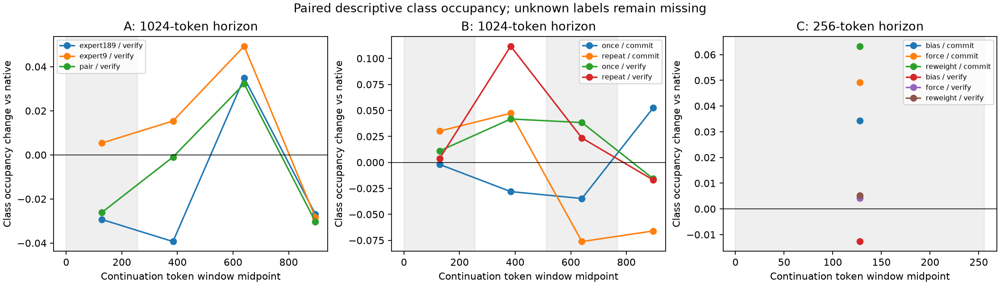
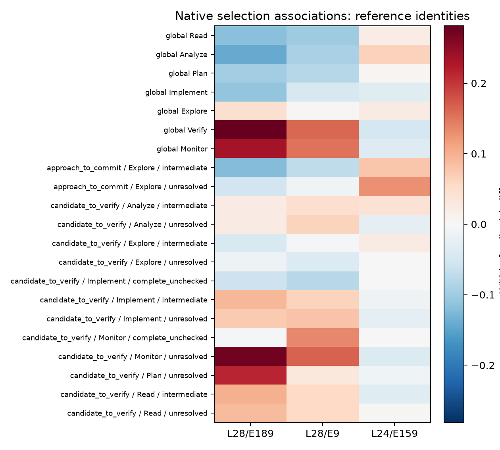
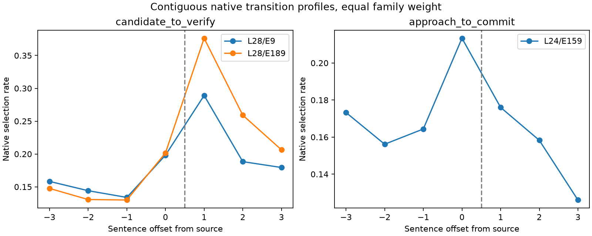
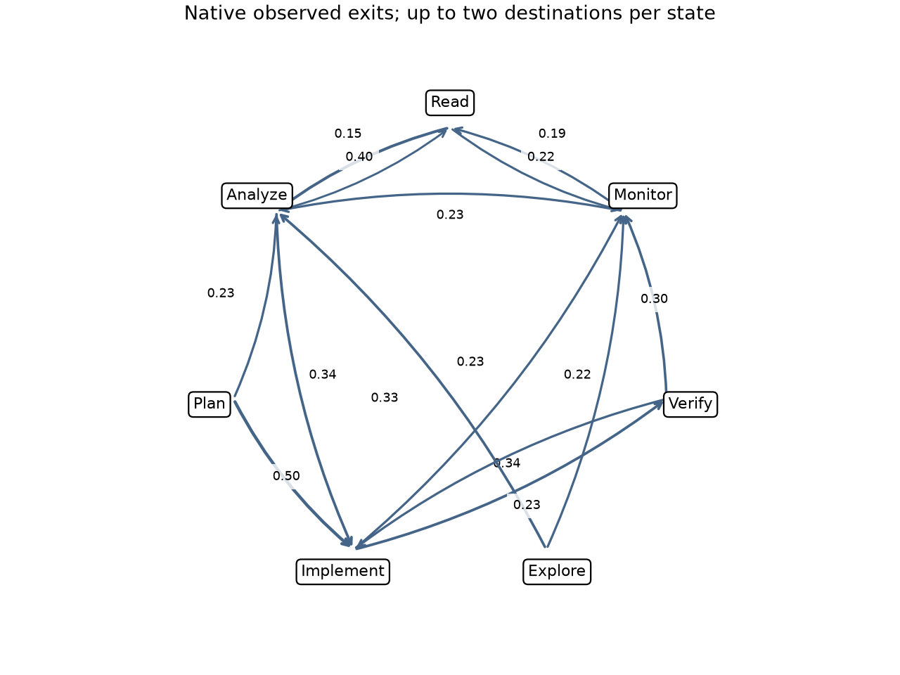

# Routing study: evidence and remaining execution

Historical A/B/C/FRESH estimates and their saved 50,000-draw intervals were reproduced exactly. Each population, cap, endpoint and inference remains separate. Capped mechanism results do not establish final-answer utility.

| Study | Cap | Assigned | Valid semantic pairs | Interpretation |
|---|---:|---:|---:|---|
| A | 1024 | 128 | 110 | Discovery mechanism evidence |
| B | 1024 | 156 | 141 | Discovery mechanism evidence |
| C | 256 | 208 | 200 | Discovery mechanism evidence |
| FRESH | 1024 | 3480 | 2920 | Discovery mechanism evidence |

Dense recovery inventory: 11,200 committed of 187,524; 176,324 missing; 8 old calls without committed outputs retained explicitly.

A does not establish an advantage of paired verification experts over either singleton. B does not establish additional benefit of the second pulse. C shows an exploratory reweighting effect in its short horizon; the degenerate bias estimate does not establish equivalence. These are substantive reader outcomes, distinct from the seven-class sentence descriptions.

| Study/scope | Contrast | Substantive success change (pp) | Frozen simultaneous 95% interval (pp) | Families |
|---|---|---:|---|---:|
| A/all | pair − native | 6.25 | [-25.00, 50.00] | 8 |
| A/all | expert189 − native | 0.00 | [-25.00, 25.00] | 8 |
| A/all | expert9 − native | 6.25 | [-25.00, 37.50] | 8 |
| A/all | pair − expert189 | 6.25 | [-25.00, 50.00] | 8 |
| A/all | pair − expert9 | 0.00 | [-25.00, 25.00] | 8 |
| B/all | once − native | -7.69 | [-30.77, 15.38] | 13 |
| B/all | repeat − native | -11.54 | [-42.31, 0.00] | 13 |
| B/all | repeat − once | -3.85 | [-26.92, 15.38] | 13 |
| B/candidate_to_verify | once − native | -12.50 | [-43.75, 25.00] | 8 |
| B/candidate_to_verify | repeat − native | -18.75 | [-62.50, 0.00] | 8 |
| B/candidate_to_verify | repeat − once | -6.25 | [-37.50, 25.00] | 8 |
| B/approach_to_commit | once − native | 0.00 | [0.00, 0.00] | 5 |
| B/approach_to_commit | repeat − native | 0.00 | [0.00, 0.00] | 5 |
| B/approach_to_commit | repeat − once | 0.00 | [0.00, 0.00] | 5 |
| C/all | bias − native | 0.00 | [0.00, 0.00] | 13 |
| C/all | force − native | 0.00 | [-23.08, 23.08] | 13 |
| C/all | reweight − native | 3.85 | [0.00, 19.23] | 13 |
| C/all | force − bias | 0.00 | [-23.08, 23.08] | 13 |
| C/all | reweight − bias | 3.85 | [0.00, 19.23] | 13 |
| C/candidate_to_verify | bias − native | 0.00 | [0.00, 0.00] | 8 |
| C/candidate_to_verify | force − native | 6.25 | [-25.00, 37.50] | 8 |
| C/candidate_to_verify | reweight − native | 6.25 | [0.00, 31.25] | 8 |
| C/candidate_to_verify | force − bias | 6.25 | [-25.00, 37.50] | 8 |
| C/candidate_to_verify | reweight − bias | 6.25 | [0.00, 31.25] | 8 |
| C/approach_to_commit | bias − native | 0.00 | [0.00, 0.00] | 5 |
| C/approach_to_commit | force − native | -10.00 | [-40.00, 0.00] | 5 |
| C/approach_to_commit | reweight − native | 0.00 | [0.00, 0.00] | 5 |
| C/approach_to_commit | force − bias | -10.00 | [-40.00, 0.00] | 5 |
| C/approach_to_commit | reweight − bias | 0.00 | [0.00, 0.00] | 5 |

The complete saved contrasts, token effects, and missing-reader identification bounds are retained in HISTORICAL_INTEGRATION.json. Small-family and degenerate bootstrap limitations remain applicable.

The 0–256 and 512–768 windows are the first and repeated pulse positions. Post-pulse descriptions use only exact saved expert IDs and sentence token ownership. Unknown labels break adjacency; closure competes with state exits; caps censor unobserved exits. The complete window table separately reports routing selection, class occupancy, unknown labels, observed reasoning duration and closure. Window comparisons are descriptive and carry no new significance claims.

Bias and forced inclusion are compared using the frozen inclusion-per-intended-opportunity endpoint. Reweighting also requires executed selected-weight displacement: sparse L1/2 and target mass from saved execution-local telemetry. The dose table retains TP ranks separately and excludes padded inactive layers. Its weights are normalized executed top-k weights, not full router probabilities. Exposure, displacement and semantic effects are not treated as equivalent.

44,442 expert-condition rows meet the ten-family/three-fold direction rule for class-transition proxies. No new singleton is selected: candidate completeness and checked status still need a prefix-only semantic recognition audit. Global versus conditional signs, ranks and cosine comparisons are recorded. The prospective predictive interface fits feature selection and regularization inside family folds, but held-out predictive gain is unavailable without a qualified prefix baseline and trailing feature frame. Full router confidence and native selection-boundary gaps are unavailable.

Unchecked-candidate verification and approach commitment remain hypotheses requiring qualified prefix opportunities. Already-checked candidate closure and failed-check revision have insufficient qualified support. No causal specialist or original-prompt accuracy claim is made.

The separate native-finalization prompt-control diagnostic has zero of 32 outcomes. Native repeat variability and execution-local capture were audited; the v4 exact native-token repeat gate failed. It remains an engineering qualification failure. Counterfactual-NLL qualification remains failed; X3 remains deferred. Qualified free-generation analysis can proceed independently.

The full seven-subject MATH test source has now been pinned and downloaded under full-math-source/. The prepared family-freeze job verifies all 500 previously used MATH-500 texts, preserves prior duplicate connections, and reserves 32 validation plus 96 final families only after excluding all previously used connected families. Submission is awaiting explicit authorization of two CPUs, 32 GiB and at most one hour. No new-family outcomes have been generated or used for selection.

The independent analysis implements seed averaging within family, equal family weights, paired simultaneous 95% accuracy–cost intervals, missing-grade sensitivity, and the stated deterministic validation choice. No acceptable accuracy-loss margin is imposed. The frontier is unavailable until qualified policies and independent outcomes exist; a nonsignificant accuracy difference will not be reported as accuracy retention.

| Resource component | Observed / authorized status |
|---|---|
| Existing dense labels | 36 packed jobs, maximum 1707.23 GPU-hours including bounded recovery; packaging qualification required |
| Packaging qualification | Original job 59490750 failed before model load at the IPC path limit; shortened-path retry receipts in submissions-v4/ |
| Existing utility pilots | Jobs 59405556, 59405561, 59405635 retained and reconciled |
| Existing operator pilots | Jobs 59400762, 59400764, 59400766 retained and reconciled |
| Offline integration | Two CPUs, at most one hour; historical authorized analysis |
| Independent family freeze | 2 CPU-core-hours maximum, zero GPUs; concrete approval pending |
| New target / operator / timing / evaluation | Not submitted; complete measured generation, prefill, controller, labeling, grading, load and bounded-recovery prices required |

Policy cost includes controller-generated tokens. Processed input, controller overhead, runtime, reasoning tokens, and offline labeling/grading expenditure will be itemized separately. Accuracy damage and net correct-to-incorrect flips per exposure remain unavailable without paired final-answer grades; near-zero-dose ratios will stay descriptive.

Machine-readable inputs: STUDY_INVENTORY_v2.json, CANDIDATE_TABLE.json, INTERVENTION_MANIFEST.json. The latter retains its earlier unavailable-source snapshot; the new source and authorization proposal are separate sealed inputs. Historical source artifacts remain unchanged. This study is incomplete while label recovery, queued pilots, prefix qualification and independent evaluation are outstanding.

In this plot, source sentence 0 precedes destination sentence +1. Every included offset has a contiguous valid label chain; events and seeds are averaged within family before families receive equal weight. This separates native pre-transition profiles from routing in the destination. These sentence-scale class proxies do not qualify a 64-token timing trigger or establish a substantive verification. Token-scale anticipation remains unavailable until raw prediction-row alignment and a prefix-only baseline are qualified.

The diagram shows up to two most frequent observed exits per state. Edge labels are destination probabilities conditional on an observed state exit. Self transitions, all exit counts, dwell, re-entry and loops remain in NATIVE_BOUNDARY_PROFILES.json. Missing labels break adjacency. Selected-window ends censor termination, so no closure probability is inferred from them.
